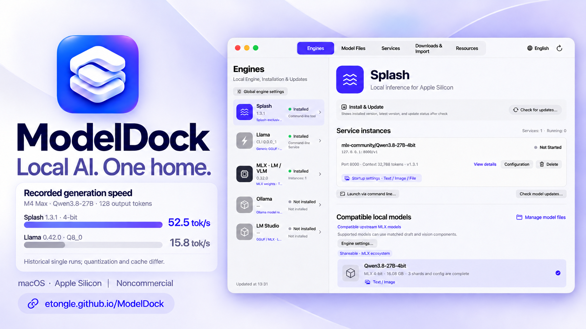
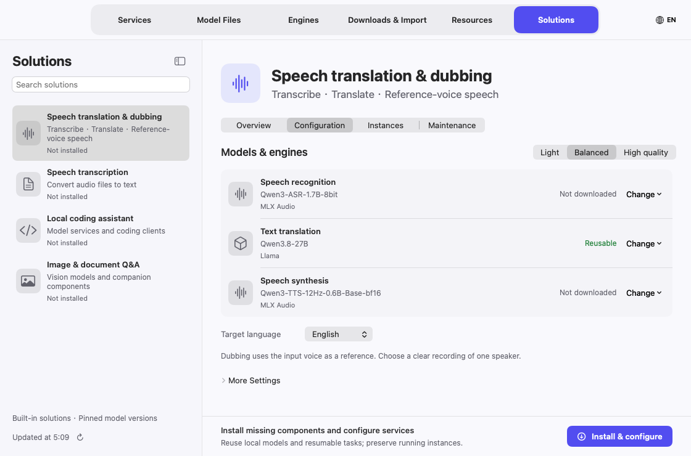

<div align="center">
  
  <h1>ModelDock</h1>
  <p>A native macOS home for your local AI models.</p>
  <p><a href="README.zh-CN.md">简体中文</a> · <a href="docs/USER_GUIDE.md">User guide</a> · <a href="docs/USER_GUIDE.zh-CN.md">中文使用说明</a></p>
</div>

ModelDock brings model runtimes, model files, downloads, and API services into one native Mac app. Download a model, choose a compatible engine, configure its input capabilities, and connect your preferred client through a direct endpoint or a shared gateway.

**Apple Silicon · macOS 14+ · English, 简体中文, Français, Português**



*Illustrated interface. Speed figures are historical single runs on M4 Max; quantization and cache differ. Documentation screenshots use demonstration data.*

**New in 0.10.2:** [Multilingual live translation](docs/USER_GUIDE.md#solutions) combines microphone captions, editable model/language settings and optional translated speech. Solution startup checks every component, including stopped reused services. Other recipe creation entries are temporarily hidden.

## What you can do

- **Manage engines:** inspect installations, check component versions, install or update supported distributions, enable or hide engines, and review uninstall or residual-file cleanup plans.
- **Manage models:** import local GGUF/Safetensors directories, inspect file completeness and compatibility, repair individual files, keep model revisions side by side, and choose a version for a future launch. See running/stopped instance counts for each model and jump to its engine instance list.
- **Control downloads:** resolve a Hugging Face `owner/repo` or a full URL, use ModelScope or GitHub repositories, GitHub Release assets, or supported direct file links. Download up to 8 models concurrently (2 by default), see per-task and per-file progress, speed and estimated time remaining, and pause or prioritize individual files. Search Hugging Face directly, with fit labels on GGUF files.
- **Run services:** configure ports, context windows, text or multimodal input, and supported runtime options; manage several independent instances; see startup stages and associated draft/vision components. Estimate memory before launch; save presets, start with ModelDock, stop when idle; try chat and compare two services side by side. Deleting models or services also removes their client registrations.
- **Live translation:** use microphone captions or audio files, choose source/target languages and models, and enable optional translated speech. Edit saved configurations without changing their gateway URLs; inspect each component’s readiness. Other recipe creation entries are temporarily hidden.
- **Connect clients:** register models with pi or OpenCode while preserving existing settings. Choose a direct endpoint or the OpenAI-compatible gateway; add remote compatible APIs to the same gateway. The gateway logs request usage (never content) and can optionally be shared on the LAN.
- **Stay in the menu bar:** monitor CPU, memory, disk usage, download progress, and measured model performance. Closing the main window keeps the app running by default; clicking outside the menu-bar panel dismisses it.
- **Update ModelDock:** check official GitHub Releases, automatically download and verify a newer Apple Silicon package, replace the app and reopen it. Model files, settings and running model services are preserved.

## Engine support

| Engine | Typical model format | Input support / integration |
| --- | --- | --- |
| Splash | Supported upstream MLX models; legacy packed models with a matching retained runtime | Text; compatible current assemblies can include images/PDFs and a matched draft model |
| Llama / llama.cpp | GGUF | Text; media requires a supported model and matching projection component |
| Ollama | Ollama-registered models | Per-model capabilities; the Ollama service manages loaded models |
| MLX-LM / MLX-VLM | MLX Safetensors directories | MLX-LM for text; MLX-VLM for supported multimodal models |
| MLX Audio | Supported Qwen3-ASR / Qwen3-TTS directories | Transcription and WAV synthesis; Base models use reference audio/text |
| LM Studio | GGUF / MLX, depending on its runtime | Models are loaded through the application or its supported CLI |
| llama.cpp · Prism | Compatible GGUF | Options and architecture support depend on the local build |
| Strata · Niko1221 | Prepared Flash-Next GGUF / Metal assemblies | Experimental Apple Silicon source installation on macOS 15+; matched MTP and optional images; local or external API |

A format label does not guarantee that every engine can run every architecture. ModelDock checks local files and launch constraints; the runtime validates the actual architecture and auxiliary components.

## Get started

1. Download the Apple Silicon DMG or ZIP from [Releases](https://github.com/etongle/ModelDock/releases).
2. Move **ModelDock.app** into **Applications**, then open it. Current distributions use an ad-hoc signature and are not Apple-notarized. If macOS blocks a trusted copy, follow [Apple's opening instructions](https://support.apple.com/102445).
3. In **Engines**, install or select a supported runtime. Homebrew is needed for the distributions managed through Homebrew; the manager itself includes its gateway Python runtime.
4. In **Downloads & Import**, enter a Hugging Face model ID, resolve it, select the required files, and download. You can also import an existing local model from **Model Files**.
5. Choose the model and a compatible engine, review text/multimodal settings, then start its service.
6. Open **Services → One-click integration** to register it with pi or OpenCode, or copy its API endpoint.
7. For translation, open **Solutions → Configuration**, choose languages and component models, then **Install and start**. Use **Edit configuration** for an existing deployment.



English is the first-launch default. Click the **globe/language button at the top right** to choose English, Chinese, French, Portuguese, or system language. You can also open **Settings → Interface language** with **⌘,**. Changes apply immediately.

Read the [illustrated user guide](docs/USER_GUIDE.md) for download management, draft models, updates, deletion, gateway setup, troubleshooting, and keyboard shortcuts.

**Settings → App updates** controls daily GitHub checks and automatic installation. **ModelDock → Check for app updates…** checks immediately. Updates wait for downloads, engine operations and model preparation to finish.

For Strata, compile its official Metal source build from **Engines**, download a supported Flash-Next quantization, then **Prepare model and components** before starting a service. Ordinary Qwen 27B weights or Splash DFlash drafts are not interchangeable with Strata's Flash-Next/MTP assembly. This integration was verified with an actual Metal/vision build and isolated API fixtures; full Flash-Next inference has not been tested in this release.

The speech pipeline was verified with real local Qwen3-ASR, Qwen3.8 and Qwen3-TTS models using a synthetic English recording, French/Portuguese translation and reference-voice WAV output. Native checks cover configuration editing, stable URLs, reused-service startup and ordered subtitle requests. Physical microphone capture still requires a user-granted permission and device test; latency depends on hardware and models.

## Build from source

You need a Mac with Apple Silicon, Xcode Command Line Tools, and Python 3 to prepare the portable runtime.

```sh
python3 prepare-runtime.py
python3 prepare-notices.py
MM_PYTHON_RUNTIME_DIR="$PWD/build/runtime-cache/python-3.13.16-20261009" bash build.sh
open build/ModelDock.app
```

The runtime archive is pinned and verified with SHA-256. Its provenance is recorded in `Resources/python-runtime.json`; bundled dependency licenses are retained in `Resources/ThirdPartyNotices`.

To create local distribution artifacts:

```sh
python3 package.py
python3 Tests/packaged_release_checks.py
```

The app targets macOS 14 and later. The current release was tested on the developer's available Mac; the deployment target is not a claim of physical testing on every older macOS release.

## Documentation website

Visit the [bilingual documentation website](https://etongle.github.io/ModelDock/) for an introduction and illustrated guides. The buildless static site is in `website/`; the included GitHub Actions workflow deploys it on pushes affecting the website, or through a manual run. See [website maintenance](docs/WEBSITE.md).


GitHub Packages mirrors the installation files for automation; see [package downloads and publication](docs/PACKAGES.md). Optional website visitor statistics are viewed privately in the owner's GA4 dashboard; see [analytics setup](docs/ANALYTICS.md).

## License

ModelDock's first-party code and documentation use the **[PolyForm Noncommercial License 1.0.0](LICENSE)**. It permits uses, modifications, and redistribution for permitted noncommercial purposes. Commercial use is not granted by this license. Retain the license and required notices when redistributing.

This is a **source-available, noncommercial** project, not an OSI-approved open-source project. External engines, model weights, and bundled dependencies retain their own licenses. See [licensing details](docs/LICENSING.md) and [required notices](LICENSE-NOTICE.txt).
