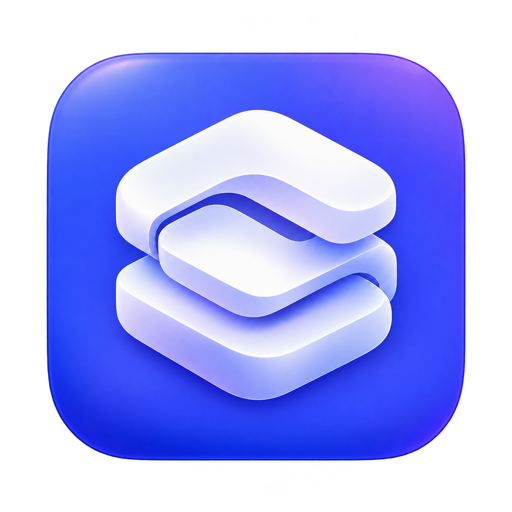

<div align="center">
  
  <h1>ModelDock · 模型坞</h1>
  <p>本地模型，一处掌控。</p>
  <p><a href="README.md">English</a> · <a href="docs/USER_GUIDE.zh-CN.md">中文使用说明</a> · <a href="docs/USER_GUIDE.md">English guide</a></p>
</div>

模型坞是一款原生 macOS 大模型管理工具，把运行引擎、模型文件、下载任务和 API 服务集中管理。下载模型后，选择兼容基座、配置输入能力，再通过独立服务或统一网关接入客户端。

**Apple Silicon · macOS 14+ · 英语、简体中文、法语、葡萄牙语**


*文档截图使用示例数据。截图中的模型大小及资源数值用于说明界面，并非性能实测。*

## 主要功能

- **运行引擎：**检查安装位置和组件版本，安装与更新支持的发行源，启用或隐藏基座，查看卸载与残留清理范围。
- **模型文件：**导入 GGUF、Safetensors 或完整目录，检查文件完整性与适配关系，修复单个文件，保留多个模型版本并为后续启动选择版本。
- **下载任务：**直接解析 Hugging Face 的 `owner/repo`、完整地址、ModelScope 仓库及支持的文件直链；续传任务，查看每个文件的进度，暂停某个文件或优先下载其他文件。
- **模型服务：**设置端口、上下文、纯文本或多模态、基座支持的运行选项；管理多个独立实例，查看启动阶段及草稿、视觉等配套组件。
- **客户端接入：**向 pi、OpenCode 的配置登记模型，保留已有设置；支持直连或 OpenAI 兼容网关，也可把远程兼容 API 加入网关。
- **菜单栏管理：**查看 CPU、内存、磁盘、下载进度和模型实测性能。默认关闭主界面继续后台运行；点击菜单栏面板外部会自动收起。

## 基座适配

| 基座 | 常见模型格式 | 输入与接入方式 |
| --- | --- | --- |
| Splash | 支持的上游 MLX 模型；旧 packed 模型使用匹配的保留运行组件 | 文本；匹配的新版组合支持图片/PDF，并使用适配草稿模型 |
| Llama / llama.cpp | GGUF | 文本；多模态需要模型支持及匹配投影组件 |
| Ollama | 已登记的 Ollama 模型 | 依模型能力而定，由 Ollama 服务管理已加载模型 |
| MLX-LM / MLX-VLM | MLX Safetensors 目录 | MLX-LM 用于文本；MLX-VLM 用于其支持的多模态模型 |
| LM Studio | 依运行时支持 GGUF / MLX | 通过原应用或支持的命令行加载模型 |
| llama.cpp · Prism | 兼容的 GGUF | 架构与选项取决于本地构建版本 |
| Strata | 外部兼容 API | 接入上游服务；当前未内置原生 Mac 安装方式 |

格式适配不代表任何架构都能运行。模型坞检查本地文件与启动约束，具体架构和辅助组件仍由实际运行引擎验证。

## 快速开始

1. 从 [Releases](https://github.com/etongle/ModelDock/releases) 下载 Apple Silicon 的 DMG 或 ZIP。
2. 将 **ModelDock.app** 拖到“应用程序”并打开。当前安装包为临时签名，尚未通过 Apple 公证；可信安装包受系统拦截时，参考 [Apple 官方说明](https://support.apple.com/102445)。
3. 在“运行引擎”选择已安装基座，或安装支持的发行版本。Homebrew 管理的基座需要 Homebrew；模型坞自身已附带网关所需的 Python 环境。
4. 在“下载导入”输入 Hugging Face 模型 ID，解析并下载所需文件；已有模型可在“模型文件”中导入。
5. 选择模型与兼容基座，检查纯文本或多模态设置，再启动服务。
6. 在“模型服务 → 一键接入”登记到 pi、OpenCode，或复制服务地址。

**首次启动默认英语。**在“设置 → 界面语言”选择简体中文、法语、葡萄牙语或跟随系统，切换立即生效。

完整操作、下载管理、草稿关联、版本更新、删除保护、网关及常见问题见[带配图的使用说明](docs/USER_GUIDE.zh-CN.md)。

## 从源码构建

需要 Apple Silicon Mac、Xcode Command Line Tools 和用于准备可移植运行环境的 Python 3。

```sh
python3 prepare-runtime.py
python3 prepare-notices.py
MM_PYTHON_RUNTIME_DIR="$PWD/build/runtime-cache/python-3.13.16-20261009" bash build.sh
open build/ModelDock.app
```

运行环境固定版本并检查 SHA-256，来源见 `Resources/python-runtime.json`，第三方许可保留在 `Resources/ThirdPartyNotices`。

生成并检查安装包：

```sh
python3 package.py
python3 Tests/packaged_release_checks.py
```

当前程序最低部署目标为 macOS 14，已在开发者现有 Mac 上验证；最低部署目标不表示已对每个旧版系统完成实机测试。

## GitHub 网站

`website/` 是无需构建的静态网站。上传仓库后，在 **Settings → Pages → Source** 选择 **GitHub Actions**；更新网站或手动运行附带工作流即可发布到 `https://etongle.github.io/ModelDock/`。维护方法见[网站说明](docs/WEBSITE.md)。

## 许可：禁止商业使用

本项目第一方代码与文档采用 **[PolyForm Noncommercial License 1.0.0](LICENSE)**，允许其规定的非商业用途下使用、修改和再分发；没有授予商业使用许可。再分发须保留许可及 Required Notice。

这是**源码可见的非商业项目**，不属于 OSI 定义的开源项目。外部基座、模型权重和附带依赖继续遵守各自许可，详见[许可说明](docs/LICENSING.md)和[Required Notice](LICENSE-NOTICE.txt)。
