# ModelDock user guide

[简体中文](USER_GUIDE.zh-CN.md) · [Project introduction](../README.md)

ModelDock separates the **engine** that runs inference, the **model files** stored on disk, and the **service** that exposes an API. One engine can have several service instances, each with its own model and port.

All screenshots in this guide use demonstration data. They illustrate controls and layout; they are not performance measurements or claims that the demonstration model was loaded.

## 1. Install and choose a language

Use an Apple Silicon Mac running macOS 14 or later. Download a DMG or ZIP from the project's Releases page, move **ModelDock.app** to **Applications**, and open it. Models and third-party engines are installed separately; the app bundles the Python runtime needed by its gateway.

Current packages use an ad-hoc signature and have not been Apple-notarized. If a trusted downloaded copy is blocked, attempt to open it, then follow the **Open Anyway** flow in **System Settings → Privacy & Security** described by [Apple](https://support.apple.com/102445). Only open distributions you trust.

English is the default on first launch, including on non-English systems. Click the **globe/language button at the top right of the main window**, then choose **English**, **简体中文**, **Français**, **Português**, or **Follow system**. In a narrow window, the button shows the globe and a language abbreviation such as **EN**. You can also open **ModelDock → Settings…** (⌘,) to change **Interface language**. The interface changes immediately and the choice is saved.

Settings has four pages: **General**, **Appearance**, **App updates**, and **Downloads**. Under **Appearance**, choose **Follow system**, **Light**, or **Dark**; the main window and menu-bar panel switch immediately. To give the details more room, drag the divider between the sidebar and the details (double-click it to restore the automatic width), or click the sidebar button at the right of a sidebar's title (or press ⌃⌘S) to collapse it; a slim rail keeps the button to bring it back. Both choices are remembered.

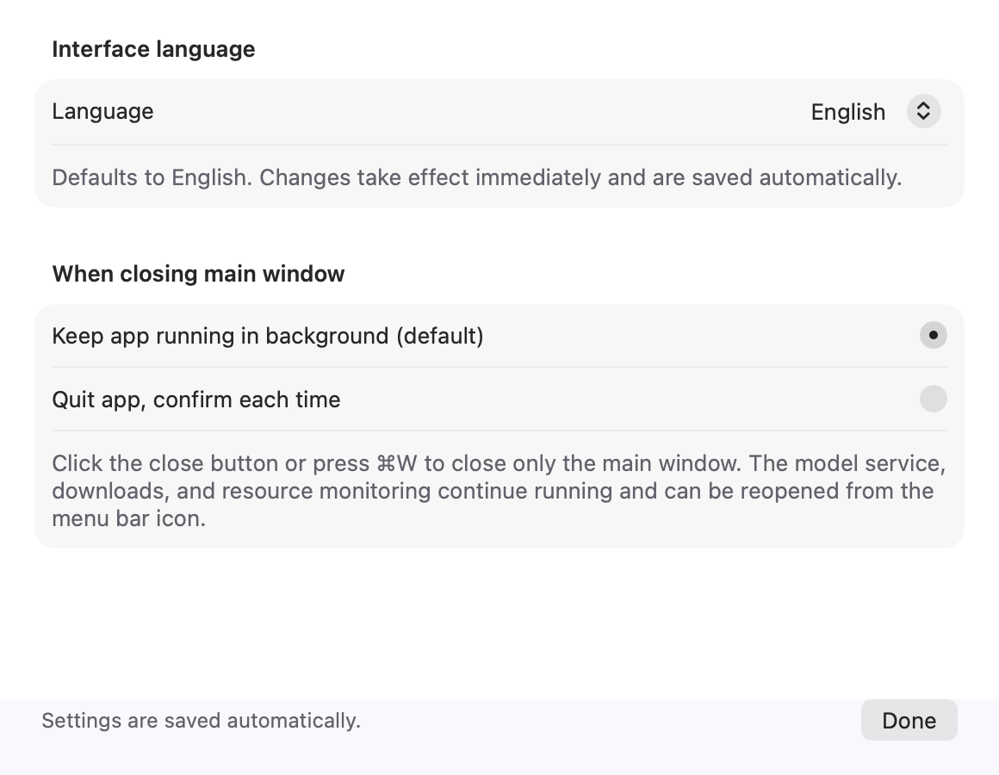

The main window closes to the background by default. A second option quits the app when closing its window, with a confirmation each time.

### Update ModelDock itself

Open **ModelDock → Check for app updates…**, or **Settings → App updates**. The section shows the installed app version, latest official GitHub version, check time, and download percentage/speed. Daily automatic checks and automatic download/installation are enabled by default; either can be disabled.

Only a newer stable release from `etongle/ModelDock` is installed. The Apple Silicon ZIP must have a GitHub SHA-256 digest. ModelDock checks that digest, archive paths, bundle identity, version, architecture, minimum macOS and code signature before replacing the app. It does not downgrade or install prereleases.

Installation waits for active model downloads, engine operations, model preparation and configuration sheets. The app then closes, replaces its bundle, and reopens, restoring menu-bar mode if hidden. Running model services retain their processes; model libraries and personal settings stay in place. The old app bundle is retained beside the installation as `.ModelDock-backup-…app`. A replacement or relaunch-command failure restores the original bundle. If the folder is not writable, install manually from Releases.

The public packages currently use ad-hoc signing; automatic updating does not make them Apple-notarized. SHA-256 verifies the package published in the official repository.

### Solutions

Open **Solutions** (⌘6). The sidebar currently shows only **Multilingual live translation**, with the existing **Overview / Configuration / Instances / Maintenance** layout. Creation entries for older recipes are hidden; their saved configurations and services remain under **Maintenance → Saved configurations for hidden solutions**.


In **Configuration**, select the source language (or Auto detect), target language, optional translated speech, and component models. Targets are English, Chinese, French, Portuguese, German, Spanish, Italian, Japanese, Korean and Russian. These settings are independent of the app language. ASR and optional TTS use MLX Audio; the translator defaults to an installed matching Qwen3.8 model or the pinned Qwen3.8 default. T3PO requires a different Chinese–English interpreting protocol and is excluded from this workflow. Light/Balanced/High quality presets select speech model sizes, not measured speed or quality guarantees.

**Install and start** installs missing engines, resumes matching downloads, verifies files, configures ports and starts components. Download details remain in **Downloads & Import**. **Check and start solution** also starts stopped reused service configurations and checks each component before exposing a ready gateway. A failure identifies the component and retains the other services. Existing audio helpers are reloaded when idle to apply the corrected audio-format handling.

For a saved configuration, click **Edit configuration**. Change languages, component models or speech output, then **Save configuration** or **Save and start**. The same solution URL is retained. Previous running model services remain manageable in Services. **Instances → Use this configuration** selects an older translation deployment.

In **Overview → Live microphone translation**, click **Start microphone translation** and grant macOS microphone permission. Original and translated captions appear after pauses or roughly six-second segments; this is segmented translation, not word-by-word simultaneous interpretation. Audio is processed by the local solution services without saving microphone recordings. If processing falls behind, capture pauses and asks you to wait and repeat the current segment. **Read translations aloud** pauses capture during playback to avoid recording its own speech. Headphones are still useful when other audio is playing.

**Audio file translation** accepts a short, clear recording up to 20 MiB and shows the transcript, translation and optional reference-voice WAV. French and Portuguese output were tested with real models and synthetic English audio; other language/device combinations should be tried with your own short sample.

Service details retain **Standalone service / Solution service / Reused by solution** labels. A solution stops only processes it explicitly started, and preserves services still referenced by other solutions. Removing a configuration retains models, engines and downloads; shared management transfers to a remaining solution. Inspect and repair files through **Change → Manage model files**.

### Per-solution gateway URL

Copy the address from **Solutions → Instances**, or **Services → Unified gateway → Solution endpoint**. Each saved deployment has its own Base URL, for example:

```text
http://127.0.0.1:18790/solutions/fba3cb54-89b0-410d-a606-17a9cdf949c4/v1
```

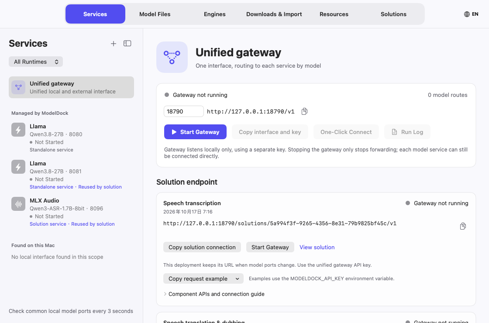

The deployment retains this URL across app restarts, component restarts, and model port changes. A new deployment with another configuration gets another URL. Changing the gateway's own port requires updating client Base URLs. **Copy solution connection** exports the URL, gateway API key, and component model names. The gateway listens only on loopback by default; optional LAN sharing uses the same gateway key. An older running gateway offers a restart control to enable these endpoints.

| Component model | Path relative to this Base URL | Use |
| --- | --- | --- |
| `asr` | `/audio/transcriptions` | Multipart file upload with `model=asr` and `file` |
| `translation` | `/chat/completions` | Supply the translation instruction and target language in messages |
| `tts` | `/audio/speech` | WAV synthesis; Base requires base64 `reference_audio` and its `reference_text` |
| `chat` / `vision` | `/chat/completions` | Chat or image questions, depending on the recipe |

Only the deployment's components appear at `GET <Base URL>/models`. `GET <Base URL>/health` reports readiness. Requests use `Authorization: Bearer <gateway API key>`. Each request invokes one component; speech translation clients call transcription, translation, and synthesis sequentially through the same Base URL. Chat JSON requests may omit `model` when only one component matches the operation. Multipart uploads must specify the component model name.

The endpoint card's **Copy request example** menu exports complete status, model-list and component requests. Export the gateway key as `MODELDOCK_API_KEY` first; scripts retain the selected solution URL without embedding its key. Transcription reads `MODELDOCK_AUDIO_FILE`. Reference-voice synthesis also needs `MODELDOCK_REFERENCE_TEXT` (the reference transcript) and `MODELDOCK_SPEECH_TEXT` (text to speak). WAV output defaults to `modeldock-speech.wav`; override it with `MODELDOCK_OUTPUT_FILE`. Image examples read `MODELDOCK_IMAGE_FILE`. Examples require curl; speech synthesis and image requests also require Python 3.

**Try solution → Trial connection** defaults to **Solution gateway**. It runs transcription, translation and synthesis through the displayed solution URL, exercising the same routes external clients use. Start the components and gateway, then wait for readiness. An unavailable gateway shows its status and start control. You can explicitly select **Direct service connection** to test the original endpoints. A gateway failure never silently switches to direct access.

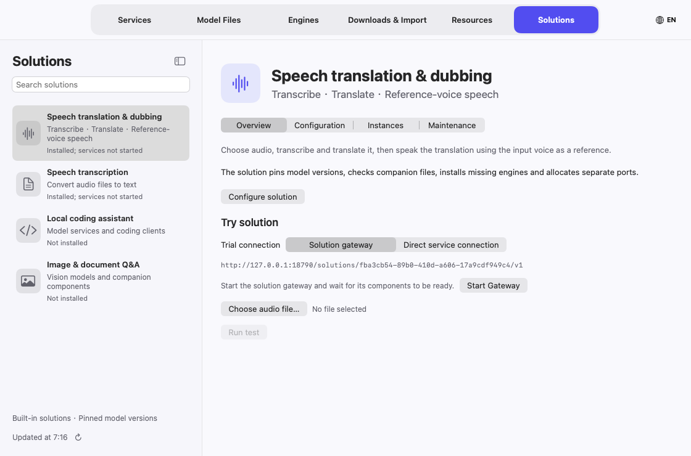

Stopped, disabled, or changed component bindings return explicit errors while retaining the URL. Removing the solution makes its URL return 404. Requests never fall back to another solution or another model with the same name. Shared standalone services retain direct access through their original addresses.

## 2. Prepare an engine

Open **Engines** and select an installed engine. An engine card can be selected anywhere in its area, including whitespace. **Global engine settings** controls which engines appear in normal lists; individual engine settings contain supported defaults and options. Each engine page is split into **Overview**, **Service instances**, **Configuration**, and **Maintenance**.

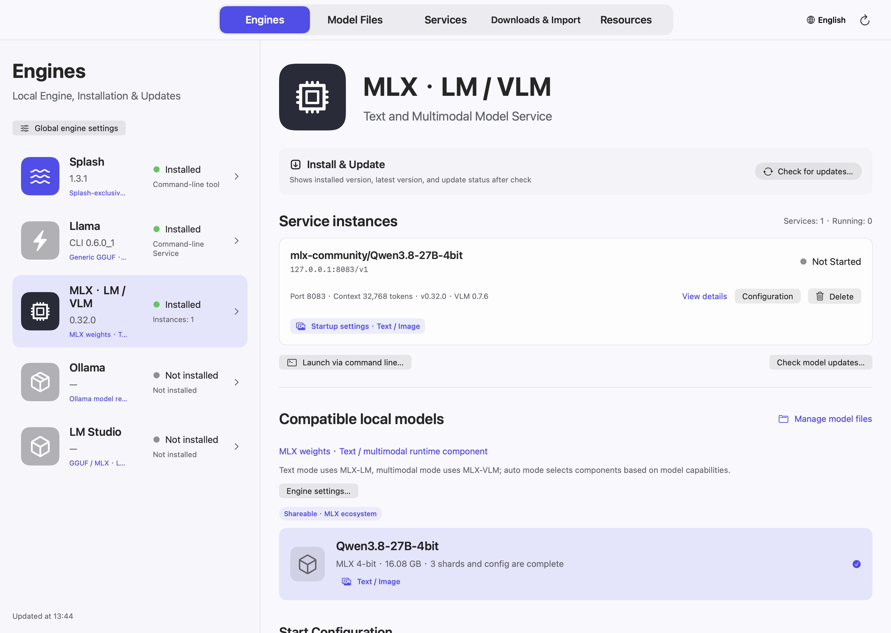

Model cards in the engine configuration and **Model Files** show instance counts for that exact local model version, with running, stopped and transitional/error states. Click the count to open **Engines → Service instances**, filtered to that model. If the model has instances under several engines, choose the engine from the count menu. **Show all instances** clears the filter. A stopped instance is a saved service configuration; deleting it reduces the count and keeps the model files.

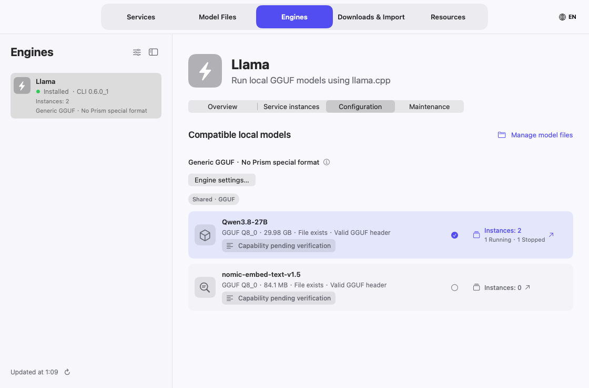

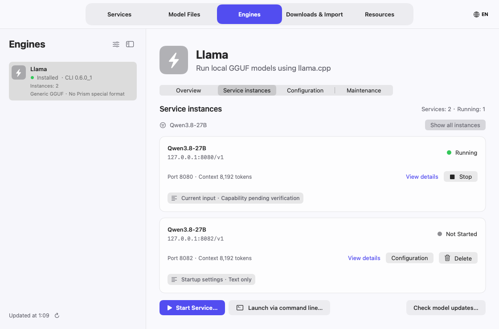

- Use **Check for updates** to inspect versions. Desktop applications and command-line components are listed separately; their version numbers are independent. **Up to date** means no update is needed from the selected source. **Update available** identifies an older component.
- Updating an engine stops the services ModelDock started with it, installs the update, then restarts them with their saved settings. If the update fails they restart on the installed version. Services of other engines are not touched; a process started outside ModelDock or an open desktop app must still be closed first.
- Homebrew-backed installation requires Homebrew. MLX components are managed in their own environment. A local build can be managed according to its identified build output.
- Review an uninstall or cleanup plan before applying it. Model files and personal data are retained by default; shared models and files in use are protected.

Disabling an engine hides it from normal selection. Existing files and service records remain available for management.

### Strata on Apple Silicon

Strata's Metal backend is experimental and requires **macOS 15+**, Apple Silicon and Xcode Command Line Tools. In **Engines → Strata → Install & Update**, review the pinned official source revision and compile it. Installation builds the Metal runtime and image encoder in an independent environment; it does not automatically download the large model weights.

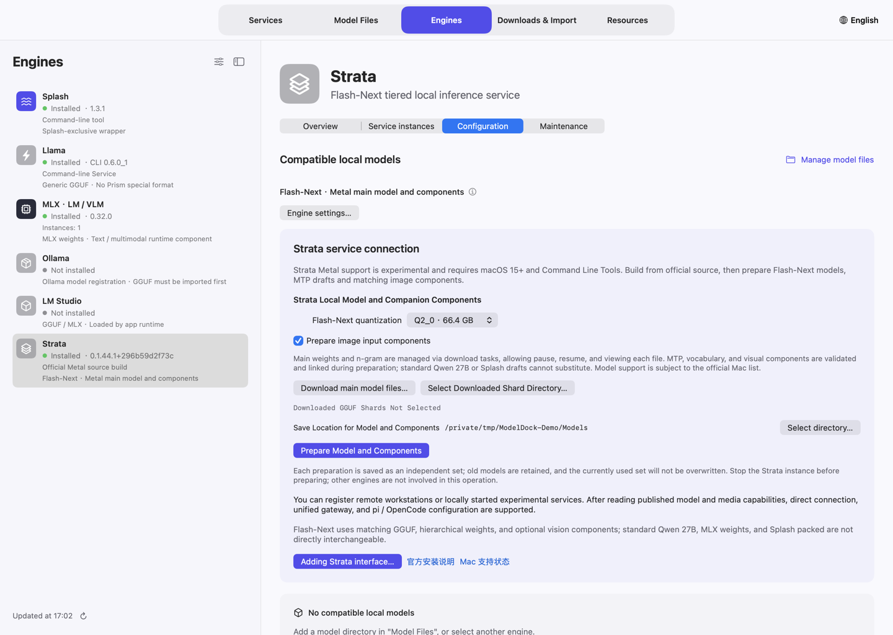

1. Choose a quantization from the official Mac catalogue: Q2_0, IQ3_XXS, IQ3_S or a supported Unsloth UD-Q4/Q5/Q6 variant. The control displays the expected main download size.
2. Click **Download main model files…**. Review the selected main shards and n-gram table in Downloads & Import, then start the download. Use task/file progress, pause and resume there.
3. Return to Strata and choose the completed GGUF shard directory. A matching completed download can be picked automatically when preparing.
4. Enable **Prepare image input components** if needed, choose the destination, and click **Prepare model and components**. This phase uses upstream verification and prepares vocabulary, model packs, MTP and optional vision files. Its log shows component progress when the upstream downloader emits it. **Pause preparation** preserves partial files; repeating the same choices resumes an incomplete combination.
5. Select the prepared model and choose automatic, text or multimodal launch mode, context and an unused port. Engine configuration can disable prepared MTP acceleration or adjust the supported speculation window. Strata's Mac server processes one request at a time and queues clients; separate service instances need their own ports and enough memory.

Each prepared combination has a separate directory. **Model Files → Associated launch components** selects a retained combination for a later launch. Running services retain their original combination. Updating Strata changes its runtime, not model files; stop only Strata services before that update. Shared weights and components in use are protected from deletion or repair.

Strata requires matched **Flash-Next weights + n-gram + vocabulary/model pack**. Its MTP component is not a Splash DFlash draft. Image support needs the prepared projection/encoder; this integration does not claim audio, video or PDF support. External Strata APIs can still be registered with the gateway and pi/OpenCode. See the [official Mac guide](https://github.com/Niko1221/Strata/blob/main/docs/MAC.md) for upstream architecture limits.

## 3. Download a model

If you do not know the repository name, search Hugging Face at the top of the page: enter keywords and pick a format (all, GGUF, MLX). Results are sorted by downloads; **Select** resolves the repository's files. GGUF files in the list are labeled **Fits this Mac**, **Tight on memory** or **Exceeds this Mac's memory** by size (context cache not included).

Open **Downloads & Import**, choose the destination library, and enter either:

```text
mlx-community/Qwen3.8-27B-4bit
https://huggingface.co/mlx-community/Qwen3.8-27B-4bit
```

A bare `owner/repo` defaults to Hugging Face. Full Hugging Face/ModelScope repository URLs and supported model-file direct links are also accepted. Restricted repositories require the correct access permission and token. The access token field is not saved to disk.

Click **Resolve URL**, inspect the listing, and choose the files:

- For a GGUF language model, normally select one desired quantization. Vision/audio support may also require the matching `mmproj` file.
- For a complete MLX directory, include all required weight shards, configuration, tokenizer, and the model's vision/processor files where applicable.
- For a draft model, follow its draft format requirements; a tokenizer may be supplied by the main model instead of the draft repository.

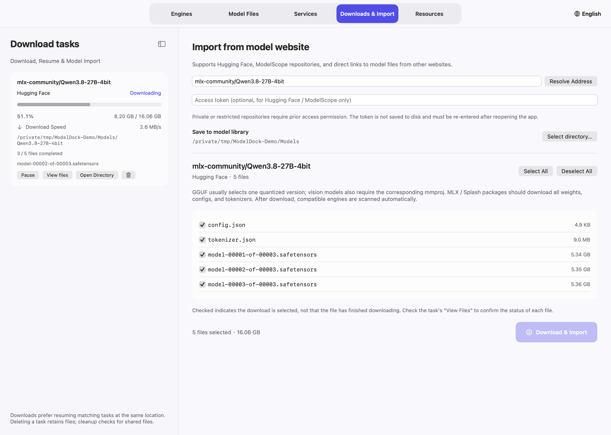

Click **Download & Import**. An existing recoverable task for the same repository, revision, selection, and destination is preferred. A currently active writer to the same destination is not duplicated. Different destinations and model revisions are managed independently.

### Per-file progress and prioritization

Click a task's **View files** action. The detail lists each file's status, downloaded bytes, percentage, and transfer speed when applicable.

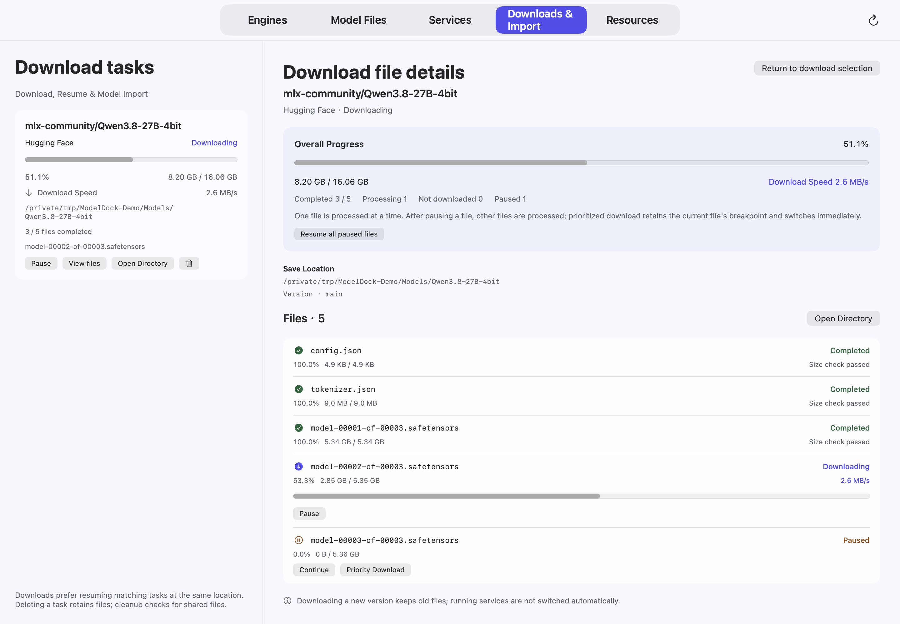

A tick in the repository's selection list means **selected for download**, not **already downloaded**. Completion is shown in task details after the relevant checks.

**New download (+)** opens a clean import page without changing running tasks. Select **Download at once** in the download sidebar, or **Settings → Downloads**, to choose 1–8 simultaneous model tasks (default: 2). Extra tasks wait in a queue and start automatically; tasks sharing a destination folder run in sequence. Reducing the limit lets already running tasks finish.

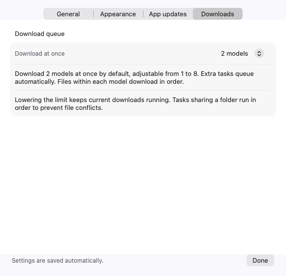

Each task shows progress, download speed and estimated time remaining. The estimate uses recent transferred bytes and may change with network speed. Size-unknown tasks wait for a size; connecting or verifying files show their actual stage. If individual files are paused, the estimate covers the active files only.

For GitHub, paste a repository URL, a `tree` subfolder, a `blob`/raw file URL, or a Release page/asset URL. Repository downloads are pinned to a commit; Git LFS pointers are resolved to model data. Select the required model and configuration files. Scripts and repository code are not executed. A bare `owner/repo` still means Hugging Face.

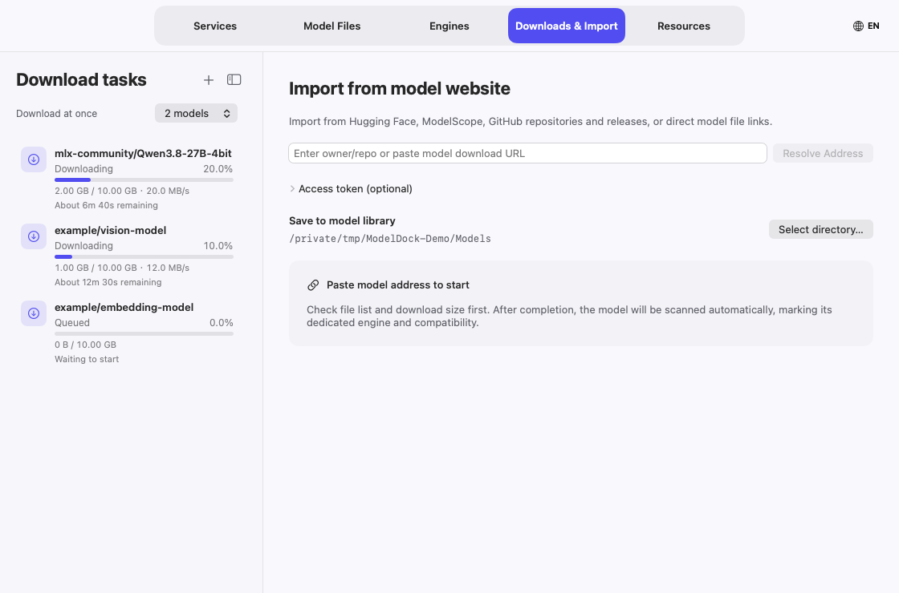

Each model downloads one file at a time. **Pause** on a file preserves its partial data and lets other files proceed; **Download first** prioritizes a different file. Resume the paused file, or resume all paused files, when ready. Closing the main window leaves downloads running; quitting the app pauses them.

### Delete a task or clean partial files

The task's trash action removes its record and preserves both completed and partial files. If it is the active task, transfer stops before its record is removed. Deleting a paused duplicate should therefore not delete the files used by the active task.

**Clean incomplete files** is a separate operation. It reviews ownership and shared destinations before removing partial data. Do not confuse that cleanup with deleting a task record.

## 4. Import and inspect local models

In **Model Files**, use **+** to add a local file or model directory. Imported files remain at their existing location. You can filter by engine or by main/auxiliary model, search by name or path, and select a card anywhere within its area.

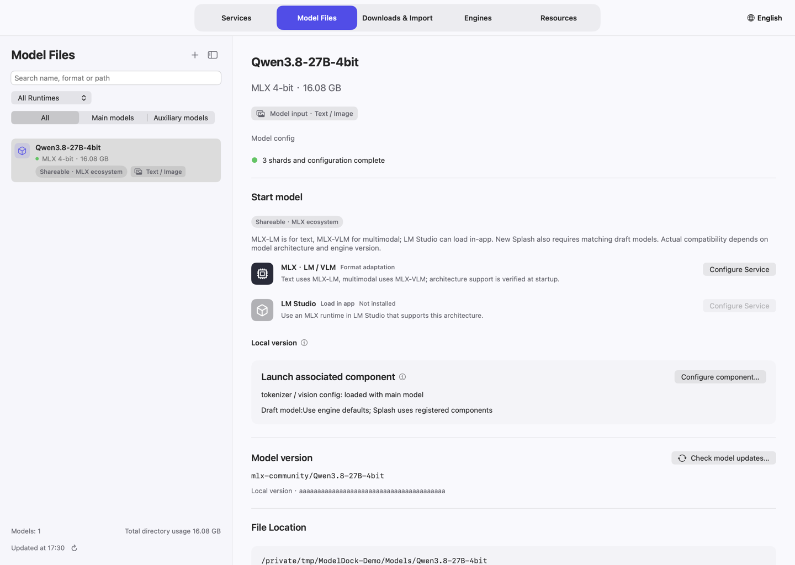

A model detail shows its format, input capabilities, source revision, file location, and compatible launch choices. Format compatibility does not guarantee architecture support. Check any warning before launching.

For a missing or damaged file, use its **Repair** action when the original repository/version is known. The manager downloads that individual file into staging, verifies it, and replaces the original target only when it is safe. A file in use, a changed target, or an incompatible source is blocked rather than replaced.

## 5. Start a model service

Click **Start Service…** — from the **+** in the Services sidebar, an engine's **Service instances**, or **Configure Service** on a model — then choose the engine and model in the sheet and review:

1. **Port:** use an unused port. Each independently hosted service needs its own endpoint; the manager identifies listeners by process identity as well as the port.
2. **Context window:** configure a size supported by the engine/model and your available memory. Client limits must match the actual service window. The panel estimates memory use as weights + context cache + runtime overhead and marks it as enough, tight or exceeding against the memory available now. It is an approximation assuming an f16 cache; when the model structure cannot be read, only the weights are counted.
3. **Input mode:** choose automatic, text-only, or multimodal where supported. A text-only model cannot gain image support through a checkbox.
4. **Auxiliary components:** choose the matching vision projector or draft model when the engine supports that component.
5. **Runtime options:** use only the options exposed for that engine. Additional supported CLI launches can be configured through **Launch from command…**.

Click **Start service**. The sheet closes and **Services** shows startup stages, available percentage information, the endpoint, and logs. A preparation/download stage may precede model loading. A phase percentage is a progress estimate for that phase, not a precise measure of all GPU work. An unreported percentage should remain unknown.

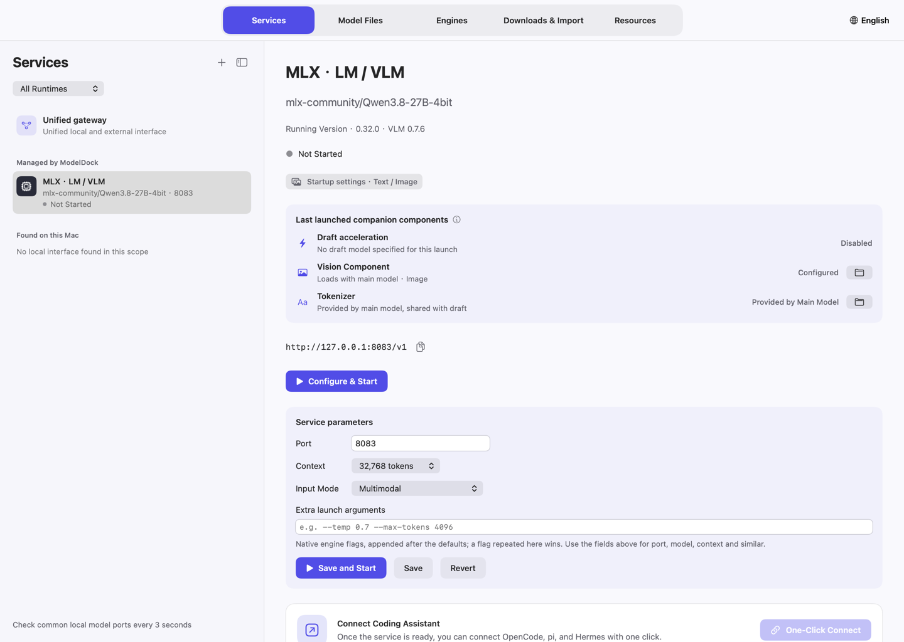

Wait until the service is ready before connecting a client. Inspect **This run's components** to confirm the active draft/vision/tokenizer components, rather than assuming a saved association was applied to an already-running service.

## 6. Associate draft and vision models

Open a main model's **Associated launch components** settings. Save a compatible draft model or matching GGUF projection file, then start a new service using that association. Changing the association affects later launches; it does not reload a running service.

For the Qwen3.8-27B family, `incoai/Qwen3.8-27B-DFlash2` is an auxiliary draft package. It is not a standalone chat model. Its `config.json` and `model.safetensors` are required; it can share the main model's tokenizer. Splash's compatible current model preparation uses a matched draft. MLX-VLM draft support depends on its runtime and architecture support; MLX-LM cannot use this DFlash2 format as a generic draft.

A vision-capable model can be run text-only when the selected runtime supports that mode. MLX multimodal services use **MLX-VLM**, not just MLX-LM. Older Splash packed models remain text-only and need their matching retained runtime.

## 7. Manage services and model versions

Every independent instance appears in **Services**, with its model, port, and status. Click anywhere on its card to select it. Stop a specific instance without stopping another one. Once stopped, its configuration can be deleted; model files and logs are retained, and its pi/OpenCode registrations are removed. A service whose model files were deleted shows a notice with **Remove Service and Integrations…**. If a client still lists registrations of deleted models or services, **Clean up stale client registrations** appears below **Connect Coding Assistant**. The copy icon after the endpoint copies the address.

**Service parameters** on the instance page lists the port, context window, input mode and engine-specific options, and can be edited in place. **Extra launch arguments** append native engine flags (for example `-ngl 99 --threads 8` for llama.cpp); flags managed by the fields above are rejected. On a running service, **Save and Restart** stops it and starts it with the new values; if that start fails, the previous settings are restored and restarted. Services created from a launch command are edited through their command instead.

**Presets** on the instance page save the context, input mode and extra launch arguments under a name for other services of the same engine; after applying one, click **Save** or **Save and Restart**. Under **Run behavior**, check **Start with ModelDock** and choose **Stop when idle**: the service stops to free memory after receiving no gateway requests with an idle CPU for the set time, and the next request through the gateway wakes it (the first request waits for the model to load). Direct requests to the service port do not wake it, and services you stop manually are never woken.

Once a service is ready, **Try chat** sends messages straight to it so you can confirm the model answers. Each reply shows first-token latency, generation speed and token count; **Chat settings** sets the system prompt, temperature and maximum output, and services that accept images let you attach them. The chat calls the service's own API, not the gateway, and writes no client configuration. Completed replies for which the service reports usage are added to **Measurement history**, marked as from chat. **Compare…** picks another running service; the same message then goes to both and the replies and speeds appear side by side.

A model update is downloaded as another revision when the source supports revision snapshots. The existing service keeps its launched path/version. After the new files are complete, select the new version and configure another launch or restart the intended service. Keep an older version to switch back later, or move it to the Trash when it is unused.

Files used by running main/auxiliary models and shared cache references are protected. Ollama manages registered models differently: deletion uses Ollama's native operation and requires the model to be unloaded. It is not a Trash operation.

Deleting a model also cleans up what refers to it, and the confirmation lists what will be removed: stopped service configurations and logs for that model, the model's pi/OpenCode registrations written by ModelDock (including a default model and pi compaction overrides), gateway route preferences for those services, draft/projector links in other models or engine defaults that pointed to the deleted files, and the model's benchmark records. Client configs are backed up before they are changed; providers and models you added yourself are untouched. Uninstalling an engine with **Remove this engine's service configs…** checked cleans up the same way.

## 8. Connect directly or through the gateway

A direct service exposes an endpoint such as `http://127.0.0.1:8083/v1`. Copy it from the service detail and select a model ID actually reported by the service.

The **Unified gateway** provides one OpenAI-compatible endpoint for enabled routes:

- Add ready local services discovered by the manager.
- Add a remote OpenAI-compatible base URL and its required credentials.
- Choose the route's model ID and enabled input modalities.
- Use the alias published by the gateway's `/v1/models`, not a guessed provider/model name.
- Keep the gateway access key private. Remote endpoints and keys are configuration, not public documentation.

The gateway and individual services remain separate endpoints. A client can use either connection method.

**LAN sharing** is off by default. When on, the gateway listens on all interfaces and shows this Mac's LAN address; other devices must send the gateway key. Turn it on only in trusted networks.

### pi and OpenCode

From a ready service, open **One-click integration**, choose the direct or gateway route, model, and working directory. **Write configuration** registers the model in the client's native settings and backs up the original configuration. Existing providers and default-model choices are preserved.

**Connect & open** starts the selected client with the prepared connection. **Copy command** is useful for manual terminal launch. After changing model limits or settings, an already-running client may need to reload/reselect the model or begin a new session.

Web search is a client/tool capability. Enable the offered search-tool integration where supported and configure any required tool credentials. It is not enabled by adding a parameter to ordinary text generation alone.

## 9. Monitor from the menu bar

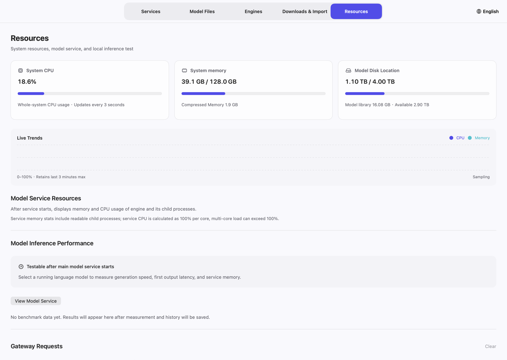

Choose **Settings → Appearance → Menu bar → Icon only** to keep the menu-bar item narrow, which helps on displays with a camera notch. Turn on **Settings → General → Startup → Launch ModelDock at login** to open ModelDock after you log in and start services marked **Start with ModelDock**; when off, it does not open automatically. It is added to Login Items in System Settings, so keep ModelDock in Applications before turning it on. **Settings → General → Notifications** sends macOS notifications when a download finishes or fails and when a service becomes ready, fails to start, or stops unexpectedly.

The menu-bar panel shows system CPU, memory, disk and library usage, service resources, downloads that are still in progress or need attention, and recent measurements when available. Click a download's management action to open the relevant task.

Clicking inside the panel keeps it usable; clicking another window or desktop area closes it. Clicking its status icon toggles the panel. **Open Management Interface** reopens the main window. Closing the main window keeps background work running by default; **Quit ModelDock** pauses downloads and stops monitoring while independently running model services remain available.

Performance values labeled as measurements come from an actual benchmark or supported service logs. Unknown measurements remain unavailable; do not compare startup estimates with generation throughput.

**Gateway Requests** lists requests made through the gateway: per-model requests, failures, input/output tokens and average time, plus recent requests. Only this metadata is recorded, never request or reply content.

The trash icon on each **Measurement history** row deletes that record. When records of deleted models remain, **Clean up deleted models** appears next to the heading; if a model is on a disconnected drive, connect it before cleaning up.

## 10. Troubleshooting

| Problem | Check / action |
| --- | --- |
| Start button disabled | Engine enabled/installed, complete compatible files, an unused valid port, correct multimodal runtime, and no scoped maintenance operation |
| Splash preparation waits on a draft | Inspect the draft download task, required files, repository access and runtime logs; the main weights being complete does not mean its auxiliary download is complete |
| Vision model starts text-only | Select multimodal/automatic mode and a runtime that loads the required vision component; MLX-LM alone is insufficient |
| Port seems to belong to the wrong engine | Inspect the listening process/service identity, then use the conflict action or another unused port |
| Context overflow / repeated compaction | Match the client's declared context to the service, reload updated client configuration, compact or restart the session, and avoid large unneeded context inputs |
| Model appears more than once | Check revision/quantization and physical file location; independent weights/revisions are different models, while shared runtime registrations should refer to the same source weights |
| Missing model file | Repair that file from the known repository/revision; otherwise resolve the source again and select the required file |
| Download speed is “—” | No active byte transfer is being measured, such as when paused, checking or completed |

Engine logs and third-party client error text may remain in the language produced by the corresponding tool.

## Shortcuts and data locations

| Shortcut | Action |
| --- | --- |
| ⌘1–⌘5 | Switch main sections |
| ⌘R | Rescan engines/models (also ↻ under the engine and model lists) |
| ⌃⌘S | Hide or show the sidebar |
| ⌘O | Add a model directory |
| ⌘, | Settings |
| ⌘W | Close the main window using the configured behavior |
| ⌘Q | Quit |

Manager state remains in `~/Library/Application Support/ModelManager` to preserve existing installations. Model files stay in their chosen library/import locations. Distribution packages and screenshots do not include personal state, credentials, or model weights.

See [licensing](LICENSING.md) for the noncommercial license and third-party boundaries.
