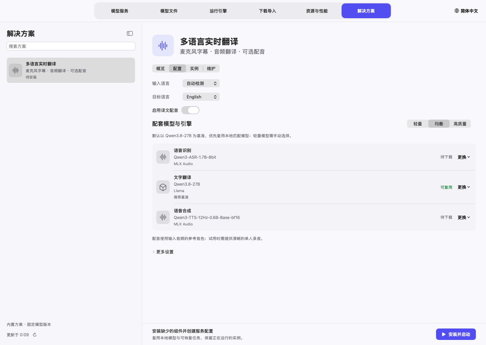
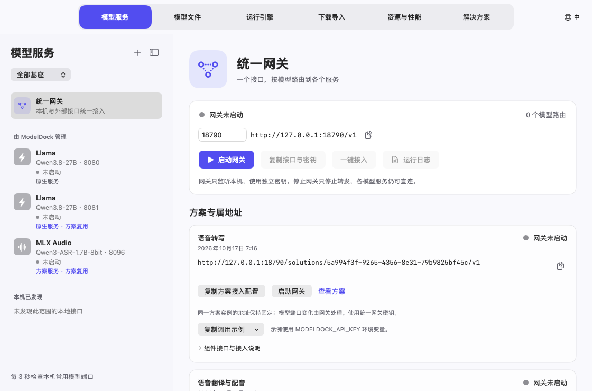
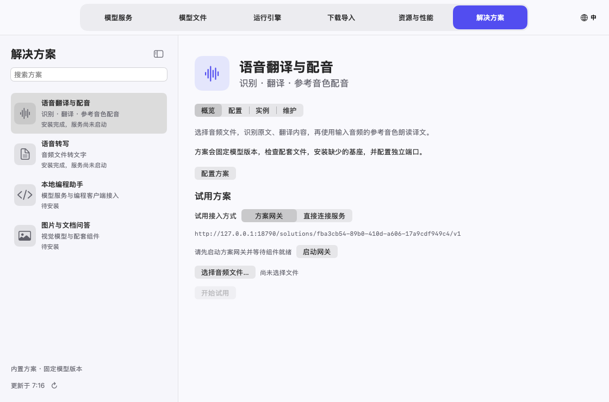
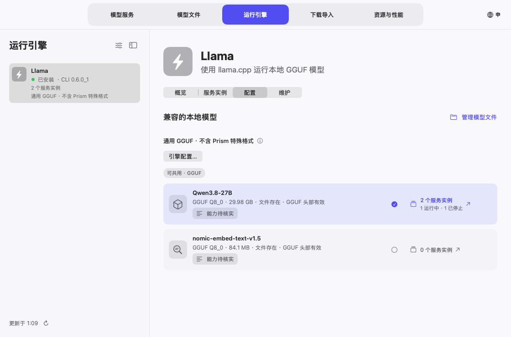
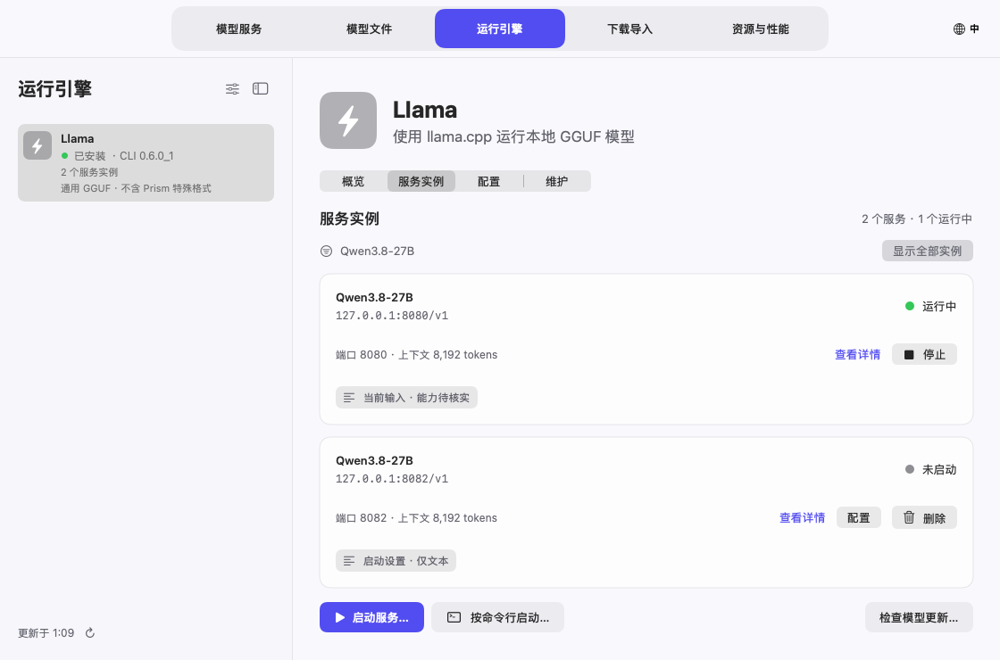
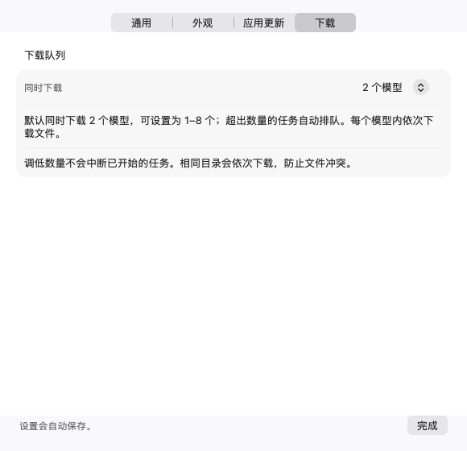
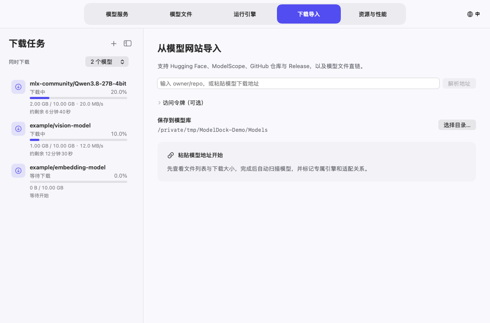

# ModelDock 模型坞使用说明

[English](USER_GUIDE.md) · [项目介绍](../README.zh-CN.md)

模型坞把三类内容分开管理：**运行引擎**负责推理，**模型文件**保存在磁盘，**模型服务**向客户端提供 API。一个基座可以启动多个独立服务，每个实例使用自己的模型和端口。

本说明的截图使用示例数据，展示的是控制项和布局；其中的大小、资源数值不是性能实测，也不代表示例模型已实际加载。

## 1. 安装与语言选择

使用 Apple Silicon、macOS 14 或更新版本的 Mac。从项目 Releases 下载 DMG 或 ZIP，把 **ModelDock.app** 放进“应用程序”并打开。模型和第三方引擎需要另外准备；应用已附带统一网关需要的 Python 环境。

当前安装包使用临时签名，尚未经过 Apple 公证。如果可信来源的安装包被拦截，先尝试打开，再按照 [Apple 官方说明](https://support.apple.com/102445)，在“系统设置 → 隐私与安全性”选择“仍要打开”。只打开可信来源的程序。

**首次启动默认英语**，不因系统为中文而改变。点击主窗口**右上角的地球/语言按钮**，直接选择 English、简体中文、Français、Português 或跟随系统。窄窗口显示地球图标和 **EN** 等语言缩写。也可在菜单 **ModelDock → Settings…**（⌘,）中修改界面语言。切换立即生效并自动保存。

设置分为**通用**、**外观**、**应用更新**和**下载**四页。在“外观”中可选择**跟随系统**、**浅色**或**深色**，主窗口和菜单栏面板立即切换。需要更大的详情区域时，可以拖动侧栏与详情之间的分隔线调整宽度（双击恢复自动宽度），或点击侧栏标题右侧的边栏按钮（或按 ⌃⌘S）收起侧栏，左侧保留窄条上的同一按钮用于展开。两项设置都会被记住。


默认关闭主窗口后保持后台运行。也可以选择关闭窗口时退出，每次退出都会再次确认。

### 更新 ModelDock 应用自身

打开 **ModelDock → 检查应用更新…** 或 **设置 → 应用更新**，查看已安装版本、GitHub 正式版、上次检查时间和下载百分比/速度。每天自动检查、自动下载并覆盖安装默认开启，可以分别关闭。

只安装 `etongle/ModelDock` 中更新的正式 Release。Apple Silicon ZIP 必须有 GitHub 提供的 SHA-256；应用会核对哈希、包内路径、应用标识、版本、架构、最低 macOS 和代码签名。不会自动降级，也不安装预发行版本。

正在下载模型、安装/清理引擎、准备模型或编辑配置弹窗时，先等待操作结束。随后应用关闭、替换自身并重新打开，原来隐藏到菜单栏时恢复该模式。运行中的模型服务继续保留，模型库和个人设置不移动。旧应用保存在安装目录旁的 `.ModelDock-backup-…app`；替换或重新打开命令失败时恢复原应用。安装目录不可写时，改用 Release 安装包手动安装。

当前发行包采用临时签名，自动更新并不代表已经通过 Apple 公证；SHA-256 用于核对官方仓库发布的文件。

### 解决方案

打开 **解决方案**（⌘6）。当前展示 **多语言实时翻译** 和 **本地生图**，沿用 **概览 / 配置 / 实例 / 维护** 分区。其他方案暂停展示新建入口，原有配置与服务保留在 **维护 → 已隐藏方案的历史配置**，不会删除共享组件。



**配置** 可选择输入语言（或自动检测）、目标语言、模型和是否启用译文配音。目标语言支持英语、中文、法语、葡语、德语、西班牙语、意大利语、日语、韩语、俄语，与界面语言分别设置。识别和可选配音使用 MLX Audio；翻译默认优先复用匹配的本地 Qwen3.8，也可下载固定版本。T3PO 需要专用中英同传协议，不再作为当前多语言流程的候选。轻量、均衡、高质量选择语音模型大小，不代表实测速度或质量承诺。

**0.10.4：**Qwen3.8 是默认推荐，不是强制翻译模型。点击文字翻译组件旁的“替换模型或服务…”可直接绑定已有兼容服务，也可在“编辑配置 → 更换 → 复用已有兼容服务”选择。菜单显示 API 模型、基座、端口和状态，同一模型的多个实例分别展示。运行服务直接复用，不重启、不重复下载；已停止的已保存服务可由方案启动。替换保留方案 ID、专属 URL 和其他组件，原服务仍可独立管理。能力检查排除图片生成、辅助模型及已知不兼容的 T3PO 协议；实际翻译效果仍需试用确认。

**安装并启动**，程序安装缺少的引擎、续传匹配下载、检查文件、配置端口并启动组件。下载详情统一在 **下载导入**。**检查并启动方案** 也会启动已停止的复用服务，按组件检查接口就绪后再提供方案网关。失败会指出具体组件，并保留其他服务。旧语音组件会在空闲时重新加载，应用音频格式修复。

已有方案点击 **编辑配置**，可修改语言、模型或配音，再 **保存配置** 或 **保存并启动**。方案专属地址保持不变；替换前已运行的服务仍可在模型服务中管理。**实例 → 使用此配置** 可选择以前保存的翻译配置。

在 **概览 → 体验方案 → 打开对话** 点击 **麦克风**，允许 macOS 麦克风权限。停顿或约 6 秒后逐段显示原文和译文，不是逐词同步同传。录音只交给本地方案服务，不保存麦克风音频。翻译跟不上收音时暂停采集，提示等待并重说当前片段。开启 **朗读译文** 后，播放期间暂停收音，避免把自身配音录回；播放其他声音时仍建议戴耳机。

**音频文件翻译** 支持不超过 20 MiB 的清晰单人短录音，显示原文、译文和可选参考音色 WAV 配音。已用真实模型验证合成英语录音的法语、葡语输出；其他语言和设备组合请先用短样本试用。

服务详情保留 **原生服务 / 方案服务 / 方案复用** 标识。方案只停止本次主动启动的进程，保留仍被其他方案引用的服务；移除配置保留模型、引擎和下载，共享管理权移交其他方案。通过 **更换 → 管理模型文件** 检查并修复文件。

### 方案专属网关地址

在 **解决方案 → 实例** 或 **模型服务 → 统一网关 → 方案专属地址** 复制方案地址。每个已保存的方案实例都有一个独立 Base URL，例如：

```text
http://127.0.0.1:18790/solutions/fba3cb54-89b0-410d-a606-17a9cdf949c4/v1
```



同一方案实例在程序重启、组件重启或模型端口变化后保留地址；采用另一配置安装的新实例会获得新地址。修改统一网关自身端口时，需要同步更新客户端 Base URL。点击 **复制方案接入配置** 可获得地址、统一网关密钥及组件模型名。网关默认只监听本机，开启局域网共享后使用同一网关密钥；已运行的旧网关会提示重启以启用新接口。

| 组件 model | 相对此 Base URL 的接口 | 用途 |
| --- | --- | --- |
| `asr` | `/audio/transcriptions` | 文件上传识别；multipart 表单包含 `model=asr` 和 `file` |
| `translation` | `/chat/completions` | 翻译模型；在消息中给出翻译指令和目标语言 |
| `tts` | `/audio/speech` | 合成 WAV；Base 模型需要 `reference_audio`（base64）和 `reference_text` |
| `chat` / `vision` | `/chat/completions` | 对话或图片问答，根据方案选择 |

各方案仅公布自身的组件。用 `GET <Base URL>/models` 查看可用组件，用 `GET <Base URL>/health` 查看就绪状态；请求须使用 `Authorization: Bearer <统一网关密钥>`。每次请求调用一个组件，语音翻译的客户端按识别、翻译、配音顺序调用同一 Base URL 下的三个接口。聊天 JSON 请求可省略 `model`，前提是当前接口在该方案中只有一个对应组件；上传表单仍需指定组件名。

地址卡片上的 **复制调用示例** 菜单可以复制状态查询、组件列表以及该方案各组件的完整请求。先把网关密钥导出为 `MODELDOCK_API_KEY`；示例固定到当前方案地址，不把密钥写进脚本。音频识别使用 `MODELDOCK_AUDIO_FILE` 指定文件。参考音色配音还需设置 `MODELDOCK_REFERENCE_TEXT`（参考音频原文）、`MODELDOCK_SPEECH_TEXT`（待朗读文字），生成文件默认保存为 `modeldock-speech.wav`，可用 `MODELDOCK_OUTPUT_FILE` 修改。图片示例读取 `MODELDOCK_IMAGE_FILE`。这些示例使用 curl，配音和图片请求另需 Python 3。

**试用方案 → 试用接入方式** 默认选择 **方案网关**，通过上方专属地址完成识别、翻译和配音，可验证提供给外部客户端的同一路由。先启动方案组件和网关，等待就绪后开始；网关未就绪时会显示原因和启动入口。也可以显式切换为 **直接连接服务** 来试用原接口。网关连接失败不会自动改用直连。



方案组件停止、被禁用或绑定的模型发生变化时，接口返回明确错误，保留地址等待恢复。移除方案配置后，该地址返回 404。不会自动改用其他方案或同名模型。共享原生服务仍可通过原地址直连。

## 2. 准备模型基座

打开“运行引擎”，选择已安装的基座。卡片的整块区域都能点击，包括留白。“全局引擎设置”控制基座是否在常规列表中展示，单个“引擎配置”保存该基座支持的默认值及选项。每个引擎页分为**概览**、**服务实例**、**配置**和**维护**四段。


引擎配置卡片和“模型文件”会显示该本地模型版本的实例数量，区分运行中、已停止、加载中和异常状态。点击数量可跳到 **运行引擎 → 服务实例**，并只显示该模型；同一模型跨多个基座时可先选基座。点“显示全部实例”清除筛选。已停止实例表示保留的服务配置，删除配置后计数减少，模型文件保留。





- 点击“检查更新”核对版本。桌面应用与命令行组件分别展示，版本号不应相互比较。“已是最新”表示当前更新源没有更高版本；“有新版本”表示对应组件可更新。
- 更新基座时，会先停止由 ModelDock 启动的该基座服务，更新完成后按原设置自动重新启动；更新失败则按当前已安装版本重新启动。其他基座的服务不受影响；外部启动的进程或已打开的桌面应用仍需先自行关闭。
- Homebrew 发行版本需要本机 Homebrew。MLX 使用独立环境管理组件，本地编译工具根据识别出的构建产物管理。
- 卸载和清理残留前先核对范围。模型和个人数据默认保留；共享模型与使用中的文件受到保护。

禁用基座会把它从常规选择中隐藏，已有文件和服务记录仍可管理。

### Splash 官方推荐模型

**0.10.4：**进入“运行引擎 → Splash → 配置”，查看官方 Qwen3.8-27B、Qwen3.6-35B-A3B、Qwen3.8-Flash-Next、Ternary Bonsai 2。选择 MLX/GGUF 量化后，点击“准备并启动…”预览命令，再确认启动。Splash 自动配对草稿、tokenizer 和可用视觉组件。ModelDock 推荐入口使用新版上游加载组件（Splash 1.3+）；Flash-Next 需要 Splash 1.4+，使用 GGUF，不推荐不受支持的 MLX。官方 Splash 要求 M3 或更新芯片、macOS 26.4+；4-bit 示例至少 36 GB 内存，推荐 48 GB，24 GB 可考虑较小 GGUF，最终由引擎检查内存。推荐依据 [官方 1.4 模型示例](https://github.com/incoai/splash/blob/1.4.0/README.md#models)，核对日期为 2026 年 10 月 22 日；推荐不代表已在本机完成整套推理测试。

### Apple Silicon 上的 Strata

Strata 的 Metal 后端为实验性支持，需要 **macOS 15+**、Apple Silicon 和 Xcode Command Line Tools。在 **运行引擎 → Strata → 安装与更新** 核对官方源码版本后编译。安装在独立环境构建 Metal 引擎和图片编码器，不会同时自动下载大体积模型权重。


1. 选择官方 Mac 列表中的 Q2_0、IQ3_XXS、IQ3_S 或支持的 Unsloth UD-Q4/Q5/Q6 量化版本，界面显示主文件预估下载量。
2. 点击 **下载主模型文件…**，在“下载导入”核对已选的主权重分片和 n-gram 表，再开始下载。这里可查看单文件进度、暂停与续传。
3. 下载完成后返回 Strata，选择完整 GGUF 分片目录；准备时也会优先使用匹配的已完成下载任务。
4. 需要图片时勾选 **准备图片输入组件**，选择保存位置，点击 **准备模型与组件**。按上游流程校验并准备词表、模型包、MTP 和可选视觉文件；上游输出的组件进度在日志中显示。**暂停准备**保留未完成文件，再次使用相同选择时继续未完成组合。
5. 选中已准备模型，设置自动/纯文本/多模态、上下文和空闲端口，启动服务。引擎配置可关闭已准备的 MTP，调整支持的推测窗口。Mac 服务一次处理一个请求，多客户端排队；多个独立服务需要不同端口和足够内存。

每次准备保存为独立组合。在 **模型文件 → 关联启动组件**选择保留的组合供后续启动。已启动服务保留原组合；更新 Strata 只更换运行组件，保留模型文件，只要求停止 Strata 自己的服务。使用中的共用权重和组件不能删除或替换修复。

Strata 需要匹配的 **Flash-Next 主权重 + n-gram + 词表/模型包**，MTP 不是 Splash 的 DFlash 草稿。图片需要已准备的投影和编码器；此集成不宣称支持音频、视频或 PDF。仍可把外部 Strata 接口加入网关和 pi/OpenCode。架构限制见[官方 Mac 说明](https://github.com/Niko1221/Strata/blob/main/docs/MAC.md)。

## 3. 下载模型

不知道仓库名时，可在页面顶部搜索 Hugging Face：输入关键词并选择格式（全部、GGUF、MLX），结果按下载量排序，点击“选择”即解析该仓库的文件。文件列表中的 GGUF 文件会按大小标注“本机可运行”“内存偏紧”或“超出本机内存”（不含上下文缓存）。

在“下载导入”选择模型库位置，输入模型 ID 或完整地址，例如：

```text
mlx-community/Qwen3.8-27B-4bit
https://huggingface.co/mlx-community/Qwen3.8-27B-4bit
```

`owner/repo` 默认到 Hugging Face 解析。也支持完整的 Hugging Face / ModelScope 仓库地址，以及支持的模型文件直链。受限仓库需要具备访问权限并填写令牌；单次任务令牌不保存在任务文件中；也可在设置中保存全局令牌到 macOS 钥匙串。

点击“解析地址”，检查文件列表：

- GGUF 语言模型一般选择一个所需量化版本；视觉、音频等模型可能还需要匹配的 `mmproj`。
- 完整 MLX 模型需要全部必需权重分片、配置、tokenizer；有视觉能力的模型还需对应 processor、视觉配置等文件。
- 草稿模型按它自己的格式下载。部分草稿由主模型提供 tokenizer，不需要给草稿仓库额外补 tokenizer。


点击“下载并导入”。对于同一仓库、版本、文件选择及保存位置，优先续传可恢复的已有任务。同一目标路径已经有写入任务时，不会再创建冲突写入；不同版本和不同位置独立管理。

### 看每个文件的进度，调整下载顺序

点击任务的“查看文件”。详细页展示文件状态、已下载大小、百分比，以及正在传输时的速度。


仓库选择列表里的勾选仅表示“选择下载”，不表示文件已经完成。下载完整并通过相关检查后，任务详情才标记为完成。

**新建下载（+）**打开全新导入页，清空上次的地址、令牌和文件选择，正在下载的任务继续运行。下载侧栏的“同时下载”或 **设置 → 下载** 可设置 1–8 个并发模型任务，默认 2 个。其余任务自动排队；共用同一目录的任务依次运行，避免文件冲突。调低并发数不会中断已开始的任务。



任务和当前文件会显示进度、速度与预计剩余时间。估算根据近期实际传输速度更新；大小未知、连接或校验时显示相应状态。若单独暂停了部分文件，剩余时间仅覆盖本轮继续下载的文件。

GitHub 支持仓库、`tree` 子目录、`blob`/raw 单文件和 Release 页面/附件地址。仓库文件固定到具体提交，Git LFS 指针会解析为实际模型数据。按需选择权重和配置文件，不会执行仓库脚本。只输入 `owner/repo` 仍默认使用 Hugging Face。



每个模型任务内依次处理文件。暂停某个文件会保留断点并继续处理其他文件；“优先下载”可把另一个文件放到前面。需要时继续指定文件或继续全部暂停文件。关闭主窗口继续下载，退出整个程序则暂停任务。

### 删除任务与清理未完成文件

任务的垃圾桶操作删除任务记录，保留已完成和未完成文件。正在下载的任务会先停止传输，再移除记录。因此，删除暂停的重复记录不会把正在被另一个任务使用的下载文件一并删除。

“清理未完成文件”是另外一个操作，清理前会检查目标及共用关系。删除记录与清理磁盘文件不是同一个操作。

## 4. 导入与检查本地模型

在“模型文件”点击 **+**，选择本地文件或完整目录。导入保留原位置，可以按基座、主模型/附属模型筛选，也可以搜索名称和路径。点击卡片任何区域即可选中。


详情展示格式、输入能力、来源版本、保存位置和兼容启动方式。支持格式不代表一定支持该架构，启动前应查看提示。

缺少或损坏的单个文件，在已知原始仓库和版本时可使用对应“修复”入口。程序只下载该文件至暂存位置，通过检查后才替换原目标。目标正在使用、文件发生变化或来源不匹配时会阻止替换。

## 5. 启动模型服务

点击“启动服务…”（模型服务侧栏的 **+**、引擎的“服务实例”分段，或模型的“配置服务”），在弹窗中选择引擎和模型，逐项检查：

1. **端口：**使用未占用的端口。独立托管的多个服务各有自己的地址；程序同时检查端口和监听进程身份。
2. **上下文：**选择引擎、模型及内存能支持的长度。客户端声明的窗口必须与真实服务一致。面板会按“权重 + 上下文缓存 + 运行开销”给出预计内存占用，并对照本机可用内存标为充足、偏紧或超出；这是按 f16 缓存估算的近似值，读不到模型结构时只计权重。
3. **输入模式：**选择自动、纯文本或支持的多模态。文本模型不能靠开关获得视觉能力。
4. **配套组件：**基座支持时，选择匹配的视觉投影或草稿模型。
5. **运行选项：**仅使用该引擎支持的参数；可通过“按命令行启动”配置额外受支持的命令行方式。

点击“启动服务”。弹窗关闭后，“模型服务”会展示启动阶段、可获取的百分比、接口地址和日志。启动可能先准备或下载辅助模型，再加载主模型。阶段百分比是阶段进度信息，不是 GPU 工作总量的精确计量；没有真实进度来源时保持未知。


服务就绪后再连接客户端。在“本次配套组件”查看实际应用的草稿、视觉和 tokenizer；已经运行的实例不会因为随后修改了关联而自动重载。

## 6. 关联草稿与视觉组件

在主模型的“关联启动组件”中选择匹配的草稿或 GGUF 投影文件，保存后启动新服务。修改关联只影响后续启动，不会重载当前运行实例。

Qwen3.8-27B 系列的 `incoai/Qwen3.8-27B-DFlash2` 是辅助草稿包，不能当作独立聊天模型运行。它需要 `config.json` 和 `model.safetensors`，可以共用主模型 tokenizer。匹配的新版 Splash 组合使用适配草稿；MLX-VLM 的草稿支持依赖具体运行时与架构，MLX-LM 不能把该格式当成通用草稿加载。

视觉模型可以在引擎支持时按纯文本启动。MLX 多模态需要 **MLX-VLM**，只有 MLX-LM 不够。旧 Splash packed 模型仍是纯文本，使用匹配的保留运行组件。

## 7. 服务实例与模型版本

“模型服务”列出每个独立实例的模型、端口和状态。整块卡片可选中，可以停止其中一个实例而保留另一个。停止后可删除该服务配置，模型文件和日志保留，该服务在 pi/OpenCode 中的接入登记会一并移除。模型文件已被删除的服务会显示提示，并提供“移除服务及相关接入”。如果客户端里还留有已删除模型或服务的登记，“接入编程助手”下方会出现“清理失效的接入登记”。接口地址后的复制图标可直接复制地址。

实例页的“服务参数”列出端口、上下文、输入模式和该引擎的专属选项，可直接修改。“附加启动参数”用于追加引擎原生参数（如 llama.cpp 的 `-ngl 99 --threads 8`），已由上方字段管理的参数会被拒绝。运行中的服务点击“保存并重启”，会停止后用新参数启动；新参数启动失败时自动按原参数恢复。由启动命令创建的服务请通过编辑命令修改。

实例页的“参数预设”可把上下文、输入模式和附加启动参数存成命名预设，套用到同类引擎的其他服务；套用后仍需点“保存”或“保存并重启”。“运行方式”中可勾选“随 ModelDock 启动”，并设置“空闲自动停止”：服务在设定时间内没有网关请求、CPU 也空闲时自动停止以释放内存，之后经统一网关发来的请求会自动唤醒它（首个请求需等待模型加载），直接访问服务端口不会唤醒。手动停止的服务不会被唤醒。

服务就绪后点击“试聊”，可直接向该服务发送消息，确认模型能正常回答。回复下方显示首字延迟、生成速度和 token 数；“对话参数”中可设置系统提示词、温度和最大输出，支持图片输入的服务还可以附加图片。试聊直接调用服务自己的接口，不经过网关，也不写入任何客户端配置。完整结束且服务报告了用量的回复会记入“实测历史”，标注“来自试聊”。点击“对比…”选择另一个运行中的服务后，同一条消息会同时发给两个服务，左右并排显示回复和速度。

支持版本快照的来源会把模型更新下载为另一个版本，已有服务继续使用启动时的路径和版本。新文件完整后，选择新版本，配置另一个实例或重启目标服务。旧版本可以保留供后续切回，也可在不使用时移至废纸篓。

运行中的主模型、辅助模型以及共享缓存受到保护。Ollama 登记模型使用原生删除操作，须先卸载常驻模型；它的删除不会经过废纸篓。

删除模型时会一并清理相关配置，确认弹窗会列出将要移除的内容：使用该模型的已停止服务配置及日志、pi/OpenCode 中由 ModelDock 写入的该模型登记（包括默认模型和 pi 的压缩设置）、网关中这些服务的路由偏好、其他模型或引擎默认设置中指向已删除草稿/投影的关联，以及该模型的测速记录。客户端配置修改前会备份，你自己添加的提供方和模型不受影响。卸载引擎时勾选“移除该引擎的服务配置……”也会按同样规则清理。

## 8. 直连服务或使用统一网关

直接服务地址例如 `http://127.0.0.1:8083/v1`，可从服务详情复制。使用服务实际报告的模型 ID。

“统一网关”把启用的路由暴露在同一个 OpenAI 兼容接口下：

- 添加程序发现的、已经就绪的本机服务。
- 添加远程兼容 API 的 base URL 和它所需的密钥。
- 选择路由的模型及允许输入的模态。
- 使用网关 `/v1/models` 返回的别名，不凭名称猜测 provider/model。
- 保护网关访问密钥。远程接口和密钥是个人配置，不应出现在公开文档中。

网关和各个独立服务是不同地址，客户端可以选择任一接入方式。

“局域网共享”默认关闭。开启后网关监听所有网卡，页面显示本机局域网地址；其他设备必须携带网关密钥才能访问。请只在可信网络中开启。

### pi 与 OpenCode 一键接入

从就绪服务打开“一键接入”，选择直连或统一网关、目标模型及工作目录。“写入配置”登记到客户端原生配置并备份原配置，保留已有提供方和默认模型。

“接入并打开”使用准备好的连接启动客户端，“复制命令”可用于手动终端启动。更新模型限制或参数后，已经运行的客户端可能需要重载、重新选择模型或新建会话。

Web search 是客户端工具能力。支持时启用提供的搜索工具接入，并配置所需凭证；普通生成请求多加一个参数不会自动获得联网搜索。

## 9. 菜单栏管理与性能


在“设置 → 外观 → 菜单栏显示”中选择**仅图标**，可让菜单栏项更窄，在带刘海的屏幕上不易被遮挡。“设置 → 通用 → 启动”中开启“登录 Mac 时启动 ModelDock”，登录后自动打开 ModelDock，并启动标记为“随 ModelDock 启动”的服务；关闭则不自动打开。它会加入系统设置的“登录项”，建议把 ModelDock 放在“应用程序”文件夹后再开启。“设置 → 通用 → 通知”会在下载完成或失败、服务就绪、启动失败或意外退出时发送 macOS 通知。

菜单栏面板显示 CPU、内存、磁盘、模型库、服务资源、进行中或需要处理的下载任务及已有测量结果。下载任务的管理入口会跳转到对应任务。

面板内操作正常响应，点击其他窗口或桌面区域会自动收起；点击状态图标切换展开/关闭。“打开管理界面”重新显示主窗口。默认关闭主窗口继续后台任务；“退出模型管理”会暂停下载、停止监测，独立运行的模型服务继续可用。

标为实测的性能来自实际测量或支持的运行日志，没有数据时不编造数值。启动估算进度与生成吞吐量是不同指标，不应混用。

服务显示名称统一采用关联的本地模型名称；旧命令实例依据准确的仓库及已固定版本识别。API 模型 ID 单独展示，保持原值；实例 ID、端口、启动配置和网关路由均不改变。

模型服务边栏支持 **全部 / 已启动 / 已停止** 筛选，并可叠加模型基座条件。已启动包含正在加载、正在停止的实例；已停止包含进程已退出的失败配置。外部接口仅在就绪时显示于已启动。状态变化后列表自动更新；从其他页面跳转到实例时，会解除挡住它的筛选；“清除筛选”恢复完整列表。筛选操作不会启动或停止服务。

### 每个服务实例的性能测试

打开 **模型服务 → 选择实例 → 实例性能 → 性能测试**；运行引擎的服务实例卡片也有同一入口。测试前需启动此实例并等待就绪，停止的实例仍可查看历史。一个接口提供多个模型时，可先选择准确的 API 模型。

文本生成测量首个输出延迟（含思考）、引擎报告的生成速度、总耗时和采样峰值内存。比较时选择相同的 64/128/256 token 上限；没有 token 统计时不估算速度。语音识别需选择短音频，语音合成使用英语测试文本，Base 模型还需参考音频及对应原文；语音结果显示音频时长和实时倍率（音频时长 ÷ 总耗时，越高越快）。图片测试使用固定提示词和 seed 42 生成一张图片；向量测试显示接口耗时及返回维度。

历史按准确的服务实例与 API 模型保存，同一模型的两个实例不会混用结果。测试直接调用实例，不改启动参数；同一时间只运行一个测试。取消和失败不保存成功记录，非流式服务可能在取消后继续完成已提交的任务。历史不保存音频、识别文字、访问密钥或生成媒体。首次加载、缓存与其他请求都会影响结果。

“网关请求”显示经统一网关的请求：按模型汇总请求数、失败数、输入/输出 token 和平均耗时，并列出最近的请求。网关只记录这些元数据，不记录请求和回复内容。

“实测历史”中每条记录右侧的删除图标可单独删除该记录。存在已删除模型的记录时，标题旁会出现“清理已删除模型的记录”；如果模型位于暂未连接的磁盘，请先连接再清理。

## 10. 常见问题

| 问题 | 检查或解决方式 |
| --- | --- |
| 启动按钮不可用 | 检查引擎是否启用并安装、模型是否完整兼容、端口是否有效未占用、多模态组件是否匹配，以及目标基座是否正在维护 |
| Splash 准备卡在草稿下载 | 检查草稿任务、必需文件、仓库访问和运行日志；主模型下载完不代表辅助文件已完成 |
| 视觉模型以文本运行 | 选择多模态/自动及能够加载视觉组件的运行时；只有 MLX-LM 不够 |
| 端口被错误标为其他基座 | 检查实际监听进程和服务身份，再使用冲突处理或改为未占用端口 |
| 上下文溢出、重复压缩 | 核对客户端与服务的真实窗口，重载客户端新配置，压缩或重开会话，减少不必要的大上下文输入 |
| 模型看起来重复 | 检查版本、量化和实际权重位置。不同版本/独立权重应分开，同一权重的多引擎登记应关联在同一来源下 |
| 缺少单个模型文件 | 来源和版本已知时修复该文件；否则重新解析来源并选择必需文件 |
| 下载速度显示“—” | 当前没有测量字节传输，例如暂停、校验或完成状态 |

第三方引擎日志和客户端错误可能保留原工具的语言。

## 快捷键与保存位置

| 快捷键 | 操作 |
| --- | --- |
| ⌘1–⌘5 | 切换主页面 |
| ⌘R | 重新扫描（引擎和模型列表底部的 ↻ 也可） |
| ⌃⌘S | 收起或展开侧栏 |
| ⌘O | 添加模型目录 |
| ⌘, | 设置 |
| ⌘W | 按设置关闭主窗口 |
| ⌘Q | 退出程序 |

为兼容已有安装，程序状态继续保存在 `~/Library/Application Support/ModelManager`；模型保存在所选模型库或导入位置。安装包和文档截图不包含个人配置、凭证或模型权重。

非商业使用要求和第三方许可边界见[许可说明](LICENSING.md)。


### 本地生图

进入“解决方案 → 本地生图 → 配置”。推荐基座卡片显示 MFLUX 的版本与状态；没有安装时可一键安装，过程可查看日志。模型权重由下载队列单独管理，支持复用已安装模型或兼容服务。默认使用完整的 Qwen-Image-2.1-Turbo，约 32.45 GB；Heretic 选项尚待完整推理验证。

服务就绪后，点击“打开生图”或概览中的“打开 GPT Image Playground”。浏览器页面使用当前方案的生图服务，并自动配对已运行、支持图片与文本的本地对话服务；无需填写 API 地址或密钥。若没有可用的对话服务，仍可在画廊生图和编辑，启动合适的对话服务后从方案重新打开即可连续对话。真实网关密钥留在本机适配器中，不注入网页。

在聊天中继续描述修改要求，或在消息下方点击“编辑图片”；卡片及详情中的“编辑输出”也会直接打开遮罩编辑器。涂选要改的区域，保存后输入修改要求。画板评论和文字描述位置不会自动成为像素遮罩。连续编辑会携带参考图；有遮罩时，输出中未选中的像素与该参考图一致，避免全图反复重绘。已模糊的旧结果无法自动恢复，应从清晰原图重新编辑。遮罩内效果仍取决于模型。

尺寸支持预设比例与自定义宽高，每边 256–2048，32 的倍数，长宽比不超过 4:1。“自动”新建默认 1024×1024，编辑保持原图尺寸；遮罩编辑要求保持原图尺寸。PNG 无损输出，使用 Turbo 标准 8 步，生成进度按实际步骤更新。增大尺寸不保证修复模糊。暂不包含 Noct-Q、Viggle、多参考图等模式。

2026-10-23，本机真实 1536×864 局部编辑保留原图尺寸，遮罩外 1,275,660 个像素变化数为 0。网页连续对话与方案自动配置也已实测；这不是其他硬件的速度或画质保证。方案专属网关地址继续支持 `model: image` 的 `/images/generations`、`/images/edits`；带遮罩的 Playground 编辑由本机适配器连接当前生图服务。

### 原始 Qwen3 权重与 Splash 启动配置

标准 `Qwen3ForCausalLM` 配置的 Qwen3 BF16 原始 Safetensors 可直接交给 MLX-LM 0.32.0 或更新版本运行。ModelDock 会核对架构和量化元数据。本机已用原始 `NiuTrans/LMT-60-8B` 将 “Good morning” 译成“早上好。”，没有转换或重复下载。适配基座被禁用时，模型页会说明原因并提供全局设置入口。

“Splash 启动配置”按当前主模型来源区分纯文本与多模态；物理组件文件相同的记录合并展示，并显示草稿名称和运行服务数量。“查看准备记录”可展开单独查看或移除记录。展示分组不会删除文件、记录或服务。模型文件页描述可选配置，模型服务页显示该服务实际选择的组件。

### 方案对话与图片 Playground

实时翻译在“概览 → 体验方案”打开独立对话窗口。每个实例分别保留会话；连续文字请求携带最近完成的翻译上下文，失败请求不作为上下文。麦克风与音频文件按顺序显示原文和译文。关闭窗口停止收音，已提交任务继续；会话保留至退出应用。“新会话”不修改模型、基座或服务。

生图方案使用 GPT Image Playground，当前方案服务与可用对话服务自动配置。聊天、参考图、生成结果保存在当前浏览器中；关闭页面再打开可继续。使用同一个本地地址与浏览器，避免切换浏览器导致看不到原会话。应用更新保留模型和服务；旧生图服务需要重启一次以加载新的遮罩与参考图支持。

### 全局 Hugging Face 令牌与模型来源

在“设置 → 下载与导入”保存全局 Hugging Face 令牌，凭据保存在 macOS 钥匙串，搜索、版本检查和下载续传会复用；单次任务令牌优先。401/403 时可在任务中重新授权并继续，已有完整文件和可续传的部分保留。令牌仍需有对应仓库权限。下载任务与模型详情可打开 Hugging Face 来源页。检查模型更新会分别显示新版本、版本相同但缺文件、已完整或来源未知；可补充仓库地址，来源未知时不会假定已更新。
