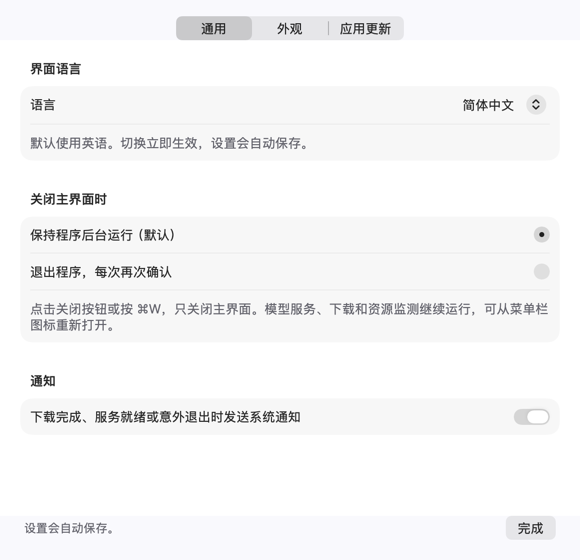
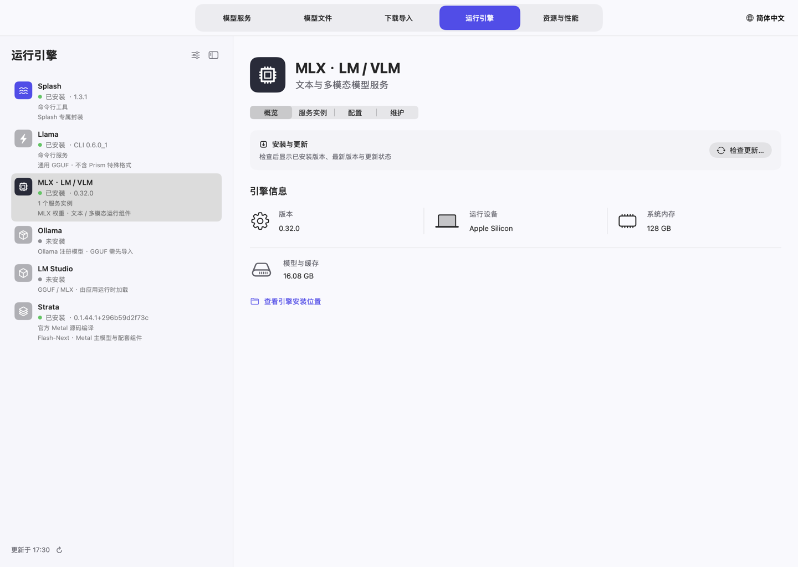
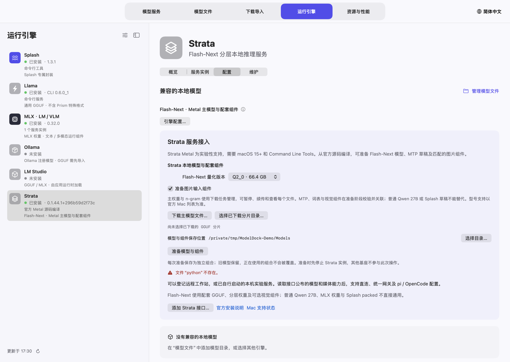
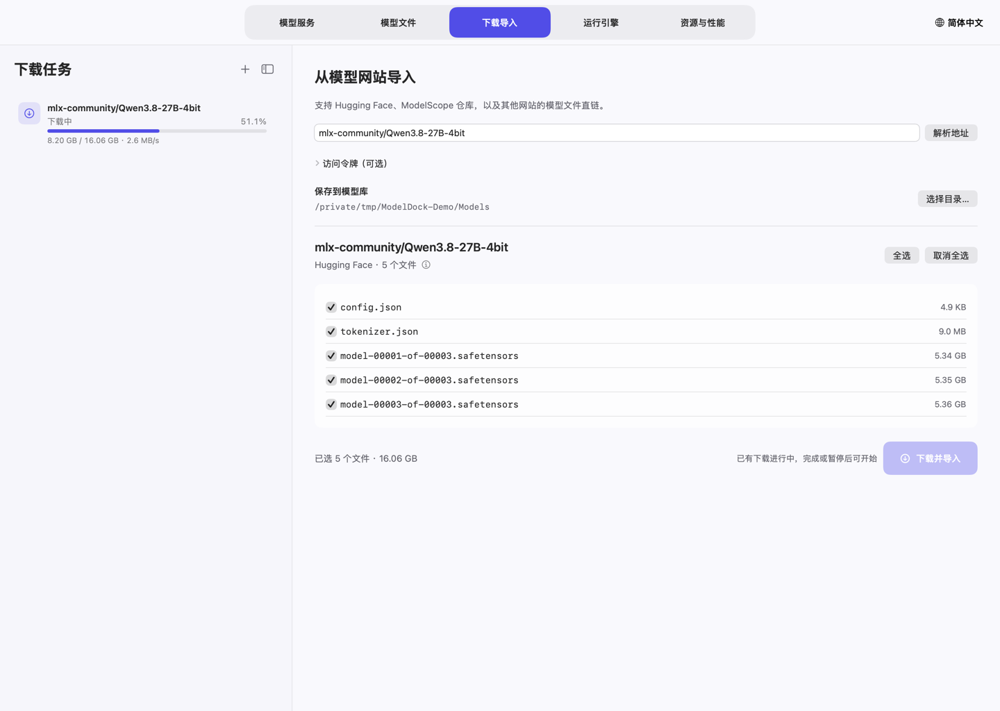
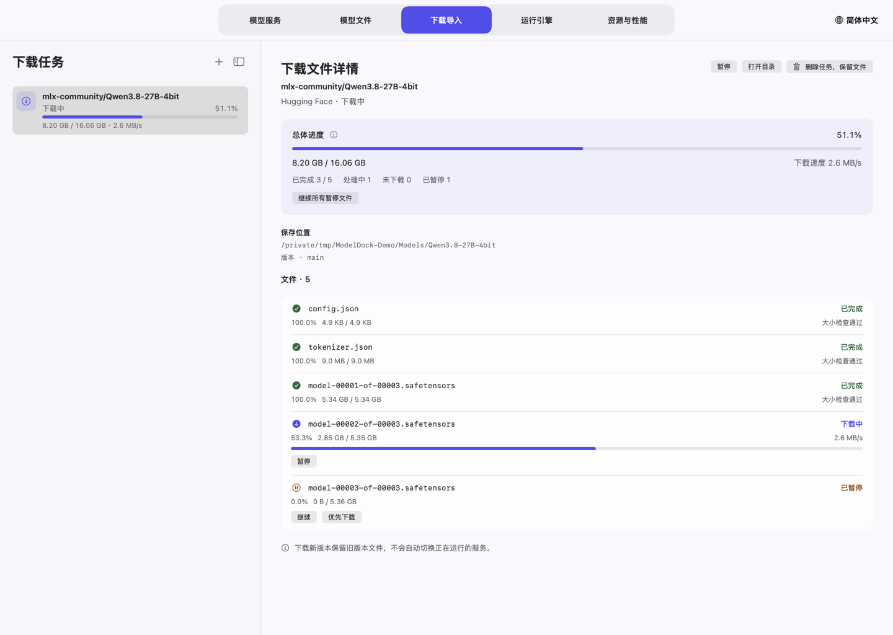
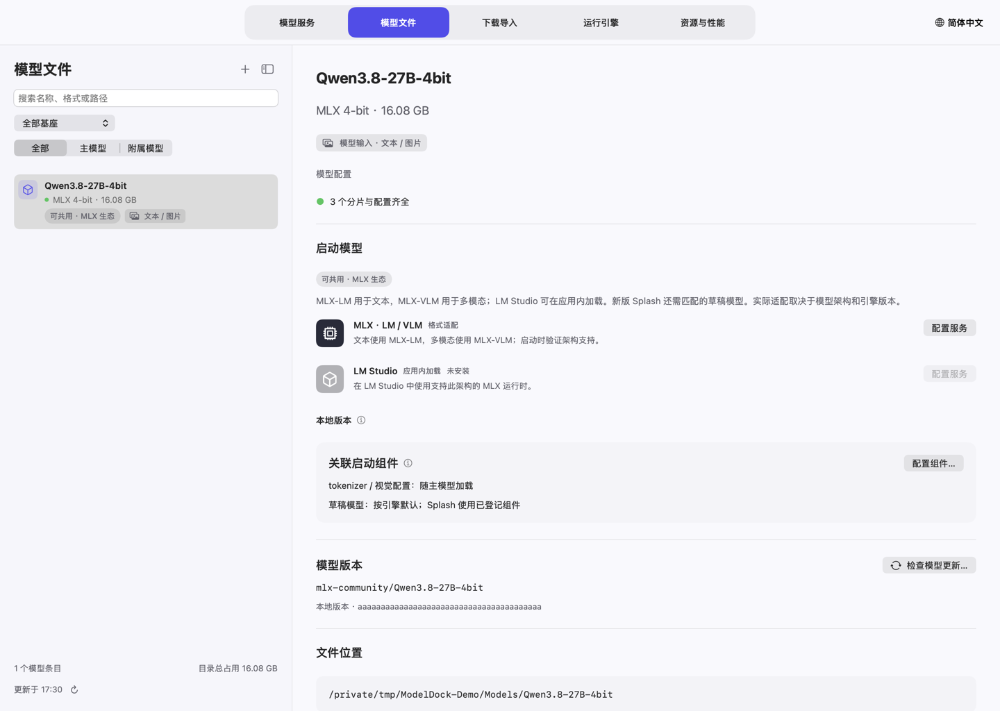
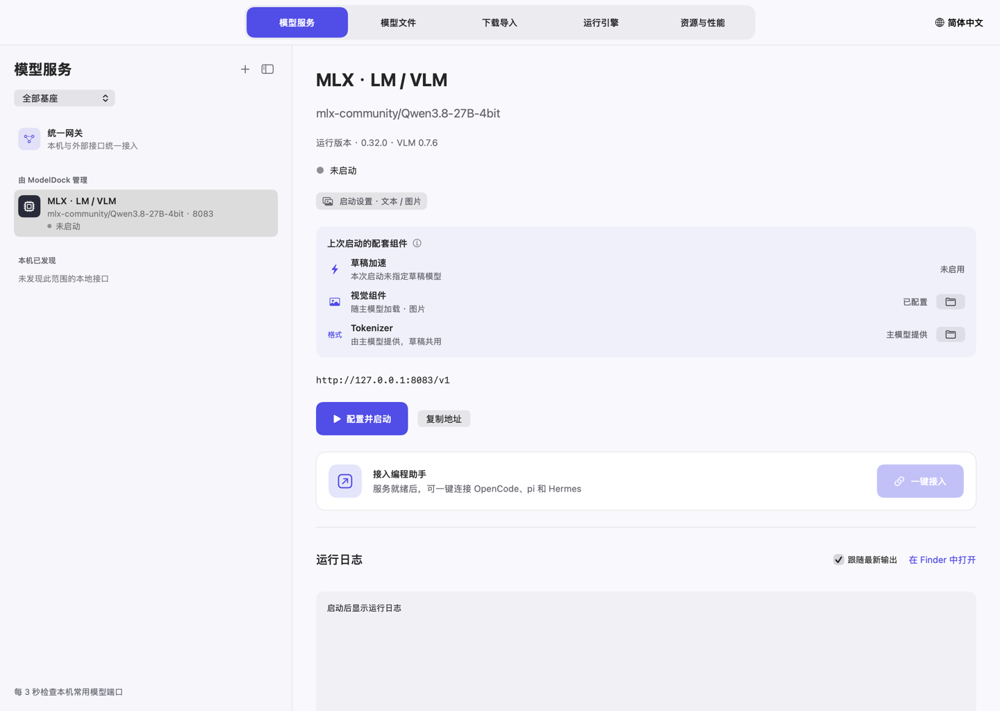
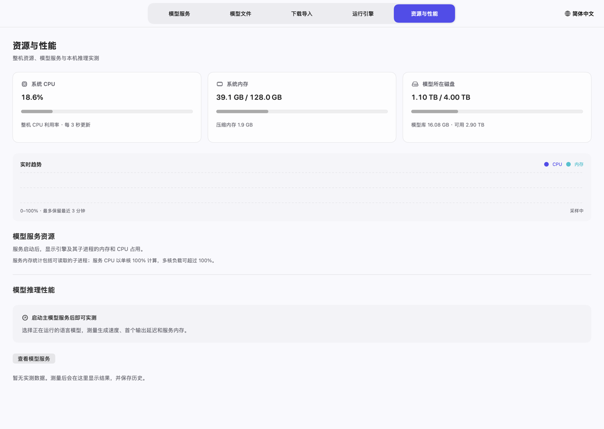

# ModelDock 模型坞使用说明

[English](USER_GUIDE.md) · [项目介绍](../README.zh-CN.md)

模型坞把三类内容分开管理：**运行引擎**负责推理，**模型文件**保存在磁盘，**模型服务**向客户端提供 API。一个基座可以启动多个独立服务，每个实例使用自己的模型和端口。

本说明的截图使用示例数据，展示的是控制项和布局；其中的大小、资源数值不是性能实测，也不代表示例模型已实际加载。

## 1. 安装与语言选择

使用 Apple Silicon、macOS 14 或更新版本的 Mac。从项目 Releases 下载 DMG 或 ZIP，把 **ModelDock.app** 放进“应用程序”并打开。模型和第三方引擎需要另外准备；应用已附带统一网关需要的 Python 环境。

当前安装包使用临时签名，尚未经过 Apple 公证。如果可信来源的安装包被拦截，先尝试打开，再按照 [Apple 官方说明](https://support.apple.com/102445)，在“系统设置 → 隐私与安全性”选择“仍要打开”。只打开可信来源的程序。

**首次启动默认英语**，不因系统为中文而改变。点击主窗口**右上角的地球/语言按钮**，直接选择 English、简体中文、Français、Português 或跟随系统。窄窗口显示地球图标和 **EN** 等语言缩写。也可在菜单 **ModelDock → Settings…**（⌘,）中修改界面语言。切换立即生效并自动保存。

设置分为**通用**、**外观**和**应用更新**三页。在“外观”中可选择**跟随系统**、**浅色**或**深色**，主窗口和菜单栏面板立即切换。需要更大的详情区域时，可以拖动侧栏与详情之间的分隔线调整宽度（双击恢复自动宽度），或点击侧栏标题右侧的边栏按钮（或按 ⌃⌘S）收起侧栏，左侧保留窄条上的同一按钮用于展开。两项设置都会被记住。



默认关闭主窗口后保持后台运行。也可以选择关闭窗口时退出，每次退出都会再次确认。

### 更新 ModelDock 应用自身

打开 **ModelDock → 检查应用更新…** 或 **设置 → 应用更新**，查看已安装版本、GitHub 正式版、上次检查时间和下载百分比/速度。每天自动检查、自动下载并覆盖安装默认开启，可以分别关闭。

只安装 `etongle/ModelDock` 中更新的正式 Release。Apple Silicon ZIP 必须有 GitHub 提供的 SHA-256；应用会核对哈希、包内路径、应用标识、版本、架构、最低 macOS 和代码签名。不会自动降级，也不安装预发行版本。

正在下载模型、安装/清理引擎、准备模型或编辑配置弹窗时，先等待操作结束。随后应用关闭、替换自身并重新打开，原来隐藏到菜单栏时恢复该模式。运行中的模型服务继续保留，模型库和个人设置不移动。旧应用保存在安装目录旁的 `.ModelDock-backup-…app`；替换或重新打开命令失败时恢复原应用。安装目录不可写时，改用 Release 安装包手动安装。

当前发行包采用临时签名，自动更新并不代表已经通过 Apple 公证；SHA-256 用于核对官方仓库发布的文件。

## 2. 准备模型基座

打开“运行引擎”，选择已安装的基座。卡片的整块区域都能点击，包括留白。“全局引擎设置”控制基座是否在常规列表中展示，单个“引擎配置”保存该基座支持的默认值及选项。每个引擎页分为**概览**、**服务实例**、**配置**和**维护**四段。



- 点击“检查更新”核对版本。桌面应用与命令行组件分别展示，版本号不应相互比较。“已是最新”表示当前更新源没有更高版本；“有新版本”表示对应组件可更新。
- 更新基座前，需要停止它自己的运行服务；其他基座的服务不应阻止本次操作。
- Homebrew 发行版本需要本机 Homebrew。MLX 使用独立环境管理组件，本地编译工具根据识别出的构建产物管理。
- 卸载和清理残留前先核对范围。模型和个人数据默认保留；共享模型与使用中的文件受到保护。

禁用基座会把它从常规选择中隐藏，已有文件和服务记录仍可管理。

### Apple Silicon 上的 Strata

Strata 的 Metal 后端为实验性支持，需要 **macOS 15+**、Apple Silicon 和 Xcode Command Line Tools。在 **运行引擎 → Strata → 安装与更新** 核对官方源码版本后编译。安装在独立环境构建 Metal 引擎和图片编码器，不会同时自动下载大体积模型权重。



1. 选择官方 Mac 列表中的 Q2_0、IQ3_XXS、IQ3_S 或支持的 Unsloth UD-Q4/Q5/Q6 量化版本，界面显示主文件预估下载量。
2. 点击 **下载主模型文件…**，在“下载导入”核对已选的主权重分片和 n-gram 表，再开始下载。这里可查看单文件进度、暂停与续传。
3. 下载完成后返回 Strata，选择完整 GGUF 分片目录；准备时也会优先使用匹配的已完成下载任务。
4. 需要图片时勾选 **准备图片输入组件**，选择保存位置，点击 **准备模型与组件**。按上游流程校验并准备词表、模型包、MTP 和可选视觉文件；上游输出的组件进度在日志中显示。**暂停准备**保留未完成文件，再次使用相同选择时继续未完成组合。
5. 选中已准备模型，设置自动/纯文本/多模态、上下文和空闲端口，启动服务。引擎配置可关闭已准备的 MTP，调整支持的推测窗口。Mac 服务一次处理一个请求，多客户端排队；多个独立服务需要不同端口和足够内存。

每次准备保存为独立组合。在 **模型文件 → 关联启动组件**选择保留的组合供后续启动。已启动服务保留原组合；更新 Strata 只更换运行组件，保留模型文件，只要求停止 Strata 自己的服务。使用中的共用权重和组件不能删除或替换修复。

Strata 需要匹配的 **Flash-Next 主权重 + n-gram + 词表/模型包**，MTP 不是 Splash 的 DFlash 草稿。图片需要已准备的投影和编码器；此集成不宣称支持音频、视频或 PDF。仍可把外部 Strata 接口加入网关和 pi/OpenCode。架构限制见[官方 Mac 说明](https://github.com/Niko1221/Strata/blob/main/docs/MAC.md)。

## 3. 下载模型

在“下载导入”选择模型库位置，输入模型 ID 或完整地址，例如：

```text
mlx-community/Qwen3.8-27B-4bit
https://huggingface.co/mlx-community/Qwen3.8-27B-4bit
```

`owner/repo` 默认到 Hugging Face 解析。也支持完整的 Hugging Face / ModelScope 仓库地址，以及支持的模型文件直链。受限仓库需要具备访问权限并填写令牌；访问令牌输入框不会保存到磁盘。

点击“解析地址”，检查文件列表：

- GGUF 语言模型一般选择一个所需量化版本；视觉、音频等模型可能还需要匹配的 `mmproj`。
- 完整 MLX 模型需要全部必需权重分片、配置、tokenizer；有视觉能力的模型还需对应 processor、视觉配置等文件。
- 草稿模型按它自己的格式下载。部分草稿由主模型提供 tokenizer，不需要给草稿仓库额外补 tokenizer。



点击“下载并导入”。对于同一仓库、版本、文件选择及保存位置，优先续传可恢复的已有任务。同一目标路径已经有写入任务时，不会再创建冲突写入；不同版本和不同位置独立管理。

### 看每个文件的进度，调整下载顺序

点击任务的“查看文件”。详细页展示文件状态、已下载大小、百分比，以及正在传输时的速度。



仓库选择列表里的勾选仅表示“选择下载”，不表示文件已经完成。下载完整并通过相关检查后，任务详情才标记为完成。

目前每次处理一个文件。暂停某个文件会保留断点并继续处理其他文件；“优先下载”可把另一个文件放到前面。需要时继续指定文件或继续全部暂停文件。关闭主窗口继续下载，退出整个程序则暂停任务。

### 删除任务与清理未完成文件

任务的垃圾桶操作删除任务记录，保留已完成和未完成文件。正在下载的任务会先停止传输，再移除记录。因此，删除暂停的重复记录不会把正在被另一个任务使用的下载文件一并删除。

“清理未完成文件”是另外一个操作，清理前会检查目标及共用关系。删除记录与清理磁盘文件不是同一个操作。

## 4. 导入与检查本地模型

在“模型文件”点击 **+**，选择本地文件或完整目录。导入保留原位置，可以按基座、主模型/附属模型筛选，也可以搜索名称和路径。点击卡片任何区域即可选中。



详情展示格式、输入能力、来源版本、保存位置和兼容启动方式。支持格式不代表一定支持该架构，启动前应查看提示。

缺少或损坏的单个文件，在已知原始仓库和版本时可使用对应“修复”入口。程序只下载该文件至暂存位置，通过检查后才替换原目标。目标正在使用、文件发生变化或来源不匹配时会阻止替换。

## 5. 启动模型服务

点击“启动服务…”（模型服务侧栏的 **+**、引擎的“服务实例”分段，或模型的“配置服务”），在弹窗中选择引擎和模型，逐项检查：

1. **端口：**使用未占用的端口。独立托管的多个服务各有自己的地址；程序同时检查端口和监听进程身份。
2. **上下文：**选择引擎、模型及内存能支持的长度。客户端声明的窗口必须与真实服务一致。
3. **输入模式：**选择自动、纯文本或支持的多模态。文本模型不能靠开关获得视觉能力。
4. **配套组件：**基座支持时，选择匹配的视觉投影或草稿模型。
5. **运行选项：**仅使用该引擎支持的参数；可通过“按命令行启动”配置额外受支持的命令行方式。

点击“启动服务”。弹窗关闭后，“模型服务”会展示启动阶段、可获取的百分比、接口地址和日志。启动可能先准备或下载辅助模型，再加载主模型。阶段百分比是阶段进度信息，不是 GPU 工作总量的精确计量；没有真实进度来源时保持未知。



服务就绪后再连接客户端。在“本次配套组件”查看实际应用的草稿、视觉和 tokenizer；已经运行的实例不会因为随后修改了关联而自动重载。

## 6. 关联草稿与视觉组件

在主模型的“关联启动组件”中选择匹配的草稿或 GGUF 投影文件，保存后启动新服务。修改关联只影响后续启动，不会重载当前运行实例。

Qwen3.8-27B 系列的 `incoai/Qwen3.8-27B-DFlash2` 是辅助草稿包，不能当作独立聊天模型运行。它需要 `config.json` 和 `model.safetensors`，可以共用主模型 tokenizer。匹配的新版 Splash 组合使用适配草稿；MLX-VLM 的草稿支持依赖具体运行时与架构，MLX-LM 不能把该格式当成通用草稿加载。

视觉模型可以在引擎支持时按纯文本启动。MLX 多模态需要 **MLX-VLM**，只有 MLX-LM 不够。旧 Splash packed 模型仍是纯文本，使用匹配的保留运行组件。

## 7. 服务实例与模型版本

“模型服务”列出每个独立实例的模型、端口和状态。整块卡片可选中，可以停止其中一个实例而保留另一个。停止后可删除该服务配置，模型文件和日志保留。

支持版本快照的来源会把模型更新下载为另一个版本，已有服务继续使用启动时的路径和版本。新文件完整后，选择新版本，配置另一个实例或重启目标服务。旧版本可以保留供后续切回，也可在不使用时移至废纸篓。

运行中的主模型、辅助模型以及共享缓存受到保护。Ollama 登记模型使用原生删除操作，须先卸载常驻模型；它的删除不会经过废纸篓。

## 8. 直连服务或使用统一网关

直接服务地址例如 `http://127.0.0.1:8083/v1`，可从服务详情复制。使用服务实际报告的模型 ID。

“统一网关”把启用的路由暴露在同一个 OpenAI 兼容接口下：

- 添加程序发现的、已经就绪的本机服务。
- 添加远程兼容 API 的 base URL 和它所需的密钥。
- 选择路由的模型及允许输入的模态。
- 使用网关 `/v1/models` 返回的别名，不凭名称猜测 provider/model。
- 保护网关访问密钥。远程接口和密钥是个人配置，不应出现在公开文档中。

网关和各个独立服务是不同地址，客户端可以选择任一接入方式。

### pi 与 OpenCode 一键接入

从就绪服务打开“一键接入”，选择直连或统一网关、目标模型及工作目录。“写入配置”登记到客户端原生配置并备份原配置，保留已有提供方和默认模型。

“接入并打开”使用准备好的连接启动客户端，“复制命令”可用于手动终端启动。更新模型限制或参数后，已经运行的客户端可能需要重载、重新选择模型或新建会话。

Web search 是客户端工具能力。支持时启用提供的搜索工具接入，并配置所需凭证；普通生成请求多加一个参数不会自动获得联网搜索。

## 9. 菜单栏管理与性能



在“设置 → 外观 → 菜单栏显示”中选择**仅图标**，可让菜单栏项更窄，在带刘海的屏幕上不易被遮挡。“设置 → 通用 → 通知”会在下载完成或失败、服务就绪、启动失败或意外退出时发送 macOS 通知。

菜单栏面板显示 CPU、内存、磁盘、模型库、服务资源、进行中或需要处理的下载任务及已有测量结果。下载任务的管理入口会跳转到对应任务。

面板内操作正常响应，点击其他窗口或桌面区域会自动收起；点击状态图标切换展开/关闭。“打开管理界面”重新显示主窗口。默认关闭主窗口继续后台任务；“退出模型管理”会暂停下载、停止监测，独立运行的模型服务继续可用。

标为实测的性能来自实际测量或支持的运行日志，没有数据时不编造数值。启动估算进度与生成吞吐量是不同指标，不应混用。

## 10. 常见问题

| 问题 | 检查或解决方式 |
| --- | --- |
| 启动按钮不可用 | 检查引擎是否启用并安装、模型是否完整兼容、端口是否有效未占用、多模态组件是否匹配，以及目标基座是否正在维护 |
| Splash 准备卡在草稿下载 | 检查草稿任务、必需文件、仓库访问和运行日志；主模型下载完不代表辅助文件已完成 |
| 视觉模型以文本运行 | 选择多模态/自动及能够加载视觉组件的运行时；只有 MLX-LM 不够 |
| 端口被错误标为其他基座 | 检查实际监听进程和服务身份，再使用冲突处理或改为未占用端口 |
| 上下文溢出、重复压缩 | 核对客户端与服务的真实窗口，重载客户端新配置，压缩或重开会话，减少不必要的大上下文输入 |
| 模型看起来重复 | 检查版本、量化和实际权重位置。不同版本/独立权重应分开，同一权重的多引擎登记应关联在同一来源下 |
| 缺少单个模型文件 | 来源和版本已知时修复该文件；否则重新解析来源并选择必需文件 |
| 下载速度显示“—” | 当前没有测量字节传输，例如暂停、校验或完成状态 |

第三方引擎日志和客户端错误可能保留原工具的语言。

## 快捷键与保存位置

| 快捷键 | 操作 |
| --- | --- |
| ⌘1–⌘5 | 切换主页面 |
| ⌘R | 重新扫描（引擎和模型列表底部的 ↻ 也可） |
| ⌃⌘S | 收起或展开侧栏 |
| ⌘O | 添加模型目录 |
| ⌘, | 设置 |
| ⌘W | 按设置关闭主窗口 |
| ⌘Q | 退出程序 |

为兼容已有安装，程序状态继续保存在 `~/Library/Application Support/ModelManager`；模型保存在所选模型库或导入位置。安装包和文档截图不包含个人配置、凭证或模型权重。

非商业使用要求和第三方许可边界见[许可说明](LICENSING.md)。
